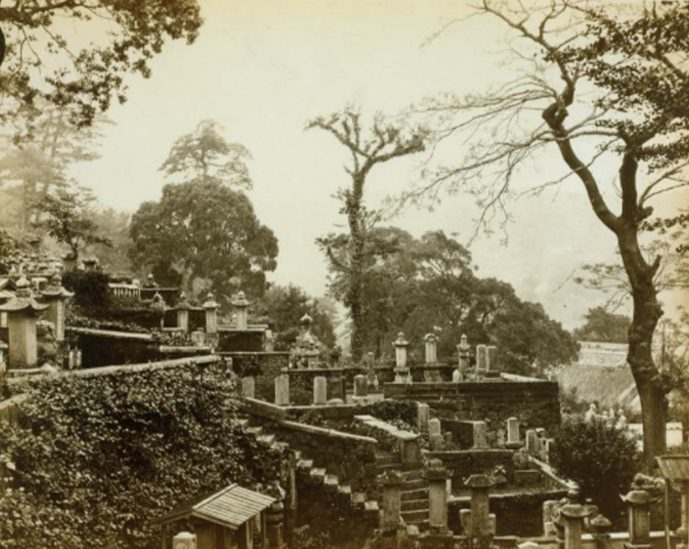

## Игорный дом «Беторозу» и бои жуков-оленей

После внезапной естественной смерти *Донёкуны Тэ* игорный дом «Беторозу» перешёл к его взрослому сыну, *Кандайне Тэ*. *Кандайна Тэ* куда веселее и дружелюбнее покойного отца — это удивило всех, даже его самого. Почти всё время его можно встретить где-нибудь в Ямагути, а в игорном доме он всегда сидит в своём кабинете.

Игорный дом «Беторозу» — небольшое заведение в квартале развлечений Ямагути, затерянное среди других игорных лавок; от всех них валит грязный дым, и всё вокруг пропитано криками мужчин, проигрывающих весь свой заработок. Чтобы разобрать любую речь дальше 3 м, нужна успешная проверка ***Слуха***. Игорный дом «Беторозу» отличается от соседей затейливой бумажной картиной с жуком-оленем у входа. Успешная проверка ***Искусства*** покажет, что на такую картину ушло много времени и, возможно, много денег.

Игорный дом — очень приземистое здание всего в два этажа; второй этаж целиком занимает кабинет *Кандайны*. Фойе совершенно пусто, большой занавес ведёт в бойцовый зал. Справа от фойе — четыре будки букмекеров: здесь посетители забирают выигрыши и делают ставки на другие состязания в Ямагути — например, на сумо и состязания лучников. Бойцовый зал — сырая вонючая комната с пятью столами; вокруг каждого — около дюжины мужчин всех сословий. Все — от крестьян до самураев и знати — толпятся вокруг этих столов, где проходят бои жуков-оленей.

Бои жуков-оленей были очень популярной азартной игрой в Японии с эпохи Эдо до конца XIX века. На расписной круг или приподнятый деревянный помост с разных сторон сажают двух самцов жука-оленя, и инстинкт заставляет их драться друг с другом. Побеждает жук, который вытолкнет соперника за круг или сбросит с помоста. Это было очень популярное занятие для ставок и заменяло настоящее сумо. Если сыщики захотят, они могут сами поставить на жука и испытать удачу. Выбрать можно из четырёх жуков, у каждого — свои характеристики.

## Разговор с Кандайной Тэ и его кабинет

Кабинет *Кандайны Тэ* — на втором этаже, с большим балконом, выходящим на улицу. Свежий рыбный воздух — настоящее облегчение после душных комнат внизу. Ничего примечательного в кабинете нет, кроме большого расписного свитка на стене с портретом нарядно одетого старика и надписью: *«Донёкуна Тэ, недавно ушедший, всегда любимый, навеки отец»*. Если показать письмо даймё, *Кандайна* охотно ответит на все вопросы сыщиков. На все — кроме вопросов о деловых приёмах и неоплаченных долгах, которыми ведал его покойный отец: успешная проверка ***Психологии*** покажет, что от них ему явно не по себе.

## Библиотека Ямагути

Публичных библиотек в Ямагути в эту эпоху нет, но, достаточно порасспросив в самом Ямагути или пройдя проверку ***Ориентирования***, сыщики узнают, что при центральном синтоистском святилище есть библиотека по истории города. Сама библиотека находится в тихом синтоистском святилище бога *Тэндзина*, синтоистского бога учёности. Все японские сыщики узнают его символы. Святилище служит местом учёбы, здесь молятся об успехах в учении, и весь день тут видно много молящихся студентов. Ночью святилище закрыто. Последовательные успешные проверки ***Работы в библиотеке*** дадут сыщикам три раздатки из библиотеки. Их можно найти и трудными проверками ***Внимания*** или спросив монаха при святилище — это займёт *1d4* часа.

*Прим. перев.: какие именно «три раздатки из библиотеки», книга не уточняет; по содержанию это, видимо, «Рассказ о летающем медведе», «Заклинание изгнания духа» и «Некролог» (с. 24–25).*

## Кладбище Ямагути и «мононокэ»

Кладбище Ямагути — прямо в центре города. Как и на всех японских кладбищах, оно поделено на множество семейных участков, на каждом — десятки могил одной семьи, некоторые тысячелетней давности: имена на них едва стёрлись за целые океаны дождей. Кладбище лежит на холме, поросшем приятной травой, отсюда открывается очень красивый вид на город Ямагути и особенно на окрестные леса. Каждая могила украшена крошечными синтоистскими, буддийскими и — очень редко — индуистскими святилищами и подношениями. Кладбище открыто круглые сутки. Днём здесь бывают разные семьи и люди, навещающие свои семейные участки; они могут сильно возмутиться, увидев, как сыщики что-то вынюхивают, и даже позвать местную стражу, приняв их за грабителей могил, присматривающихся к добыче. Участок семьи Тэ найти нетрудно. На нём пара десятков могил, но украшены они скудно — знак того, что покойного *Донёкуну Тэ* в народе не любили.

*Донёкуна Тэ* действительно призрак, но не мононокэ. Незаконченное дело, из-за которого он возвращается в мир живых, — обида на *Ямагути Хого*, который его обманул; но он слишком ленив, чтобы мстить, и предпочитает целую вечность дуться на кладбище. Днём призрак *Донёкуны* не появляется, если его не вызовет сыщик или онмёдзи заклинанием. Призрак *Донёкуны* появляется с 22:00 до 01:00, и, чтобы увидеть его в это время, игроки должны провалить проверку ***МОЩ***.

Призрак *Донёкуны Тэ* такой же, каким Донёкуна был при жизни: ворчливый, несчастный и во всех отношениях невесёлый старый хрыч. Он будет очень груб с сыщиками, станет настаивать, что он вовсе не мононокэ, и выскажет свою ненависть к *Ямагути Хого*. Призрак *Донёкуны* ничего не знает об *Идайне Синдзине* и его таинственном состоянии. Успешная проверка ***Психологии*** покажет, что всё, что он говорит, — правда, пусть и сказанная неласково. Однако он упомянет, что совсем не может спать: он слышит мстительных духов, доносящихся с горы Сёдзидакэ, — они без конца кричат и спорят о другом духе на *«другой горе»*, но её названия призрак *Донёкуны* вспомнить не может. Перед тем как сыщики уйдут, призрак *Донёкуны* сбросит ворчливую маску, снимет шапку и спросит сыщиков:

*«Мой сын. Он хорошо ест?»*

Как ответить — решают сыщики.

*Прим. перев.: так в оригинале — чтобы увидеть призрака ночью, проверку МОЩ нужно провалить.*

