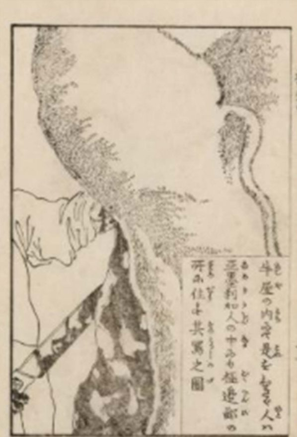
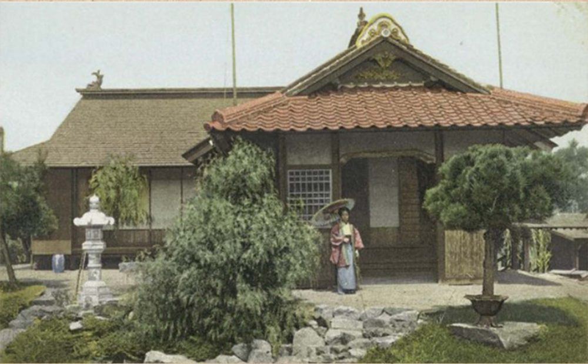

## Лавка мясника

Если сыщики пойдут по следу газетной заметки (или по каким-то другим следам), они окажутся на окраине города Ямагути, там, где лес выходит к горе Отодоияма: здесь стоит небольшая лавка мясника, о которой они могли прочитать в газете. Лавка мясника — на самом севере города Ямагути, среди небольшой кучки ветхих лачуг. Прямо к северу — тёмный, корявый лес Отодоияма, окружающий близкую гору Отодоияма. Даже добраться до лавки мясника непросто: пологие мощёные дорожки Ямагути здесь превращаются в грязные огрызки.

Сама лавка мясника — жуткое строение под соломенной крышей, едва держащееся на ногах. Это маленький дом с простым прилавком и подсобкой, где висят почти сгнившие коровьи туши. Войдя в здание, сыщики должны пройти проверку ***ВЫН***, иначе их вырвет, как только в нос ударит запах. Рядом с лавкой — остатки загона для коров, проломленного с одной стороны; середина загона залита засохшей коровьей кровью, кругом разбросаны обрубки ног и клочья мяса. Из сломанного загона в лес ведут следы около 60 см в поперечнике, похоже — с семью пальцами. Следы явно ведут к лесу, но идут беспорядочно, без всякого порядка, как рассыпанный по сковороде рис. Если спросить мясника, что случилось, он скажет так:

> *«Медведи у нас всё время бродят. Я всегда их отгоняю, но иногда они утаскивают корову. Прошлой ночью я увидел, как мне показалось, ещё одного медведя. Я заорал на него, а у него крылья и куча голов. Он схватил всех пятерых моих коров и улетел, когда я погнался за ним. Точно оникума. А чёртовы онмёдзи ничего с этим не сделают — не для нас, крестьян».*

При успешной проверке ***Оккультизма*** или ***Истории*** или если сыщик сведущ в ёкаях, он узнает в оникуме медведя-демона, известного тем, что ворует скот. Однако ни одна легенда не говорит, что у оникумы несколько голов.

## Визит сикигами

В 3 часа ночи сыщиков, которые встречались с *Курои Роху*, где бы они ни были, ждёт особый и странный визит. Сыщики, которые с ним не встречались, узнают о случившемся нападении только утром из газеты. Где бы сыщики ни были и что бы ни делали, их навестит сикигами — плоская бумажная кукла. Кукла прилетит и либо сядет на сыщика, либо будет без конца биться о стену здания, где тот находится. Когда сыщик посмотрит на куклу, она словно запаникует и упадёт, будто умерла. Игроки получают раздатку «Сикигами». Увидев «смерть» маленькой куклы, сыщики теряют *1d4* Рассудка. У сыщиков есть 20 минут, чтобы добраться от того места, где они находятся, до дома *Курои*, — иначе его убьют до их прихода.

> *Сикигами — так называют любого ёкая, которого способен призвать онмёдзи. В этом сценарии сикигами — это только летающие бумажные куклы. Сикигами этого сценария выглядят как своего рода бумажные куклы, известные по всей Японии.*
>
> *Вспомните бумажных кукол из «Унесённых призраками» (2004).*

*Прим. перев.: «Унесённые призраками» вышли в 2001 году. В оригинале «the trial of the newspaper» — видимо, «trail» («след»).*

