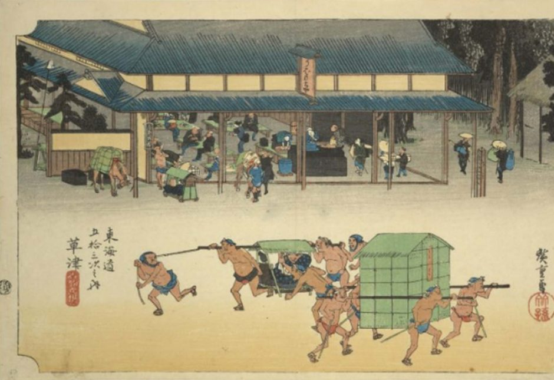

## Нападение на дом Курои (во время)

Нападение на дом *Курои Роху* выглядит по-разному в зависимости от того, придут сыщики до нападения или во время него, поэтому описания разделены. Если игроки последуют указаниям сикигами, оно приведёт их к одноэтажному дому *Курои Роху*. Это простой дом, из украшений снаружи — только балкон. Дом стоит у самого подножия горы Сёдзидакэ, прямо в центре города Ямагути. Небольшой коридор-прихожая ведёт в главную комнату, откуда лестница поднимается на балкон.

Снаружи десятки людей кричат и тревожатся, не понимая, что происходит, и никто из них не решается войти. Успешная проверка ***Слуха*** покажет, что *Курои* внутри кричит, зовя на помощь. Когда сыщики подходят к дому, у стены лежит мёртвый самурай. Вся его грудь покрыта глубокими порезами. Успешная проверка ***Первой помощи*** ничего не даст — он мёртв. Успешная проверка ***Внимания*** или ***Медицины*** покажет, что порезы похожи на следы птичьих когтей. Успешная проверка ***Естествознания*** покажет, что в Японии нет такой птицы, которая могла бы сделать подобное с самурайским доспехом.

Внутри дома *Курои* отбивается от двух псевдостарцев (если сыщиков больше четырёх, добавьте ещё одного псевдостарца). Псевдостарцы — полностью синтетические создания Старцев Ямагути; их послали убить *Курои Роху*, потому что он слишком близко подобрался к охранному заклинанию, которое вылечит *Идайну Синдзина* и разорвёт психическую хватку, которой его держат все Старцы. Увидев псевдостарца, сыщик теряет *1d6* Рассудка. Псевдостарцы не обращают внимания на сыщиков, если те сами на них не нападут или не попытаются защитить *Курои*. Если псевдостарцам дадут убить *Курои*, они быстро покинут дом и скроются в залитой кровью ночи, направляясь вверх, к горе Сёдзидакэ. Однако если сыщики просто будут стоять и смотреть, как *Курои* режут на куски, они потеряют *1d6* Рассудка.

Если сыщики обезвредят псевдостарцев, их потом можно спокойно осмотреть. Это жуткие создания светло-фиолетового цвета, похожие на мясистые бочонки с пятью странно плоскими боками; снизу торчат пять длинных когтей. На другом конце — пасть, как у миноги, со стальными зубами. Глаз у них нет, а по бокам — два перепончатых крыла, как у летучей мыши, теперь безжизненно повисших. Успешная проверка ***Естествознания*** покажет, что они вообще не должны работать как животные — у них нет крови. Кроме того, они холодные на ощупь, но на рептилий не похожи. Успешная проверка ***Оккультизма*** свяжет этих созданий с ёкаями. Поскольку псевдостарцы созданы только как убийцы, через час они рассыпаются в кучку пыли. Успешная проверка ***Естествознания*** покажет, что это точно не костный пепел. Если же сыщик знаком с металлургией, он поймёт, что порошок похож на железные опилки.

## Дом Курои после нападения

Если сыщики приходят к дому *Курои Роху* уже после его убийства, перед ними совсем другая картина. В доме полный разгром, на бумажных дверях и деревянных стенах — те же глубокие порезы. Тело *Курои Роху* лежит прямо посреди комнаты. Вся его грудь разорвана так, что ясно видны рёбра. Рук почти не осталось. Успешная проверка ***ОБР*** позволит понять, что это раны, полученные при защите. Весь северо-западный угол комнаты залит его кровью. Увидев тело, сыщики теряют *1d6* Рассудка — и ещё *1d4*, если поймут, насколько чрезмерны его раны, полученные при защите.

За домом — клочок травы, тянущийся до самого склона горы Сёдзидакэ. Там видно несколько маленьких следов, почти похожих на отметины от клейма. У следов пять чётких вмятин. Успешная проверка ***Внимания*** покажет, что оставившее следы существо передвигалось прыжками. Дом *Курои* можно осмотреть в любой момент после его смерти — о ней сыщики, скорее всего, прочтут в раздатке-газете. Разница лишь в том, что утром тело уже унесут.

## Дом Курои, если Курои жив

В доме *Курои* — несколько важнейших ключей к разгадке грязных дел Старцев с *Идайной Синдзином*. У *Курои* небольшая библиотека, посвящённая обычным для онмёдзи занятиям: множество книг о ёкаях, ками, демонах и способах бороться с ними и подчинять их. Успешная проверка ***Работы в библиотеке*** даст сыщикам указания к заклинанию *«Призвать/изгнать духа»*. Рядом с личной библиотекой — исследовательский стол, заставленный образцами тех же цветов, что в комнате *Идайны Синдзина*. Среди разбросанных бумаг и пролитых чернил спрятаны записи о создании заклинания в помощь *Идайне* — заклинания *«Разорвать психическую хватку»*.

Если сыщики спасут *Курои Роху*, он будет невероятно благодарен и честно ответит на все их вопросы. Он расскажет сыщикам о своих попытках создать заклинание в помощь *Идайне* и предложит научить их заклинанию *«Связать сикигами»* — это займёт 4 часа. Сам Курои, несмотря на нападение псевдостарцев, остаётся дома и продолжает работать над своим заклинанием; оно будет готово через 10 часов после ухода сыщиков.

