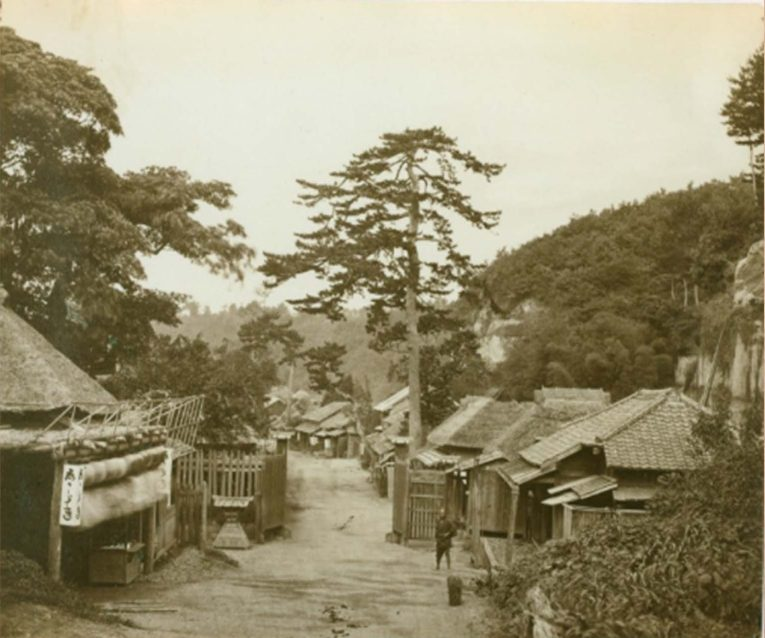

## Гора Сёдзидакэ и святилище

Гора Сёдзидакэ стоит в самом центре города Ямагути. Это скромная гора, скорее похожая на пологий склон, чем на огромный скалистый пик. Она поросла редкими деревьями и скудными горными цветами. Днём здесь красиво и мирно, вокруг часто бывают самые разные люди — паломники, обходящие десятки маленьких святилищ на горе, или гуляющие, ищущие лучший вид на город Ямагути. Если сыщики пойдут по пятипалым следам от дома *Курои Роху* — с помощью серии трудных проверок ***Внимания*** или одной обычной проверки ***Ориентирования***, — то обнаружат, что следы обрываются у одинокого святилища высотой не больше 60 см. Оно похоже на маленький домик, но идола внутри нет.

Через 5 минут, проведённых у святилища, сыщиков встретит появившийся один из Старцев Ямагути. Он словно мерцая выходит из маленького святилища: нити его медленно сплетаются, и он предстаёт светящимся, кремового цвета. На самом деле это проекция из твёрдого света, исходящая от самого святилища. Проекция может наносить и получать урон, как обычный Старец, поэтому у неё точно такой же профиль. Если сыщики были у Идайны Синдзина в его комнате, проекция холодно скажет, что узнаёт их, и напомнит: *«Убейте отверженного, или поэт умрёт»*, — и добавит: *«Вы нашли святилище, чего вы ждёте?»* Никакие отговорки сыщиков проекцию не позабавят; она знает, где искать Бракованного Старца, и с каждым вопросом, который сочтёт неуместным, злится всё сильнее. После четырёх неуместных вопросов проекция просто рассеется так же, как появилась. Если сыщики сложат картину и спросят, зачем она послала псевдостарцев убить *Курои Роху*, проекция гневно воскликнет: *«Это не дело таких, как вы»* — и больше ничего об этом не скажет. Она невероятно груба и бесполезна.

*Прим. перев.: в оригинале — «will have idea where to find the defective Elder Thing»; вероятно, пропущено «no» («понятия не имеет, где искать»). Переведено как напечатано.*

## Лавка мясника, день второй

Ранним утром второго дня Бракованный Старец снова выходит из леса Отодоияма на охоту за скотом. На этот раз мяснику удалось напасть на него и глубоко рубануть тесаком, прежде чем укрыться в лавке. Разъярённый Бракованный Старец снёс стену и убил мясника, а тело унёс в своё логово. Заметка о жуткой гибели и исчезновении мясника появится в газете.

Лавка мясника такая же, как была: коровья кровь в загоне не смыта, сам загон по-прежнему сломан. Но одна из стен лавки снесена целиком, и через весь пол лавки тянется огромный кровавый след.

## Лес Отодоияма

Лес Отодоияма начинается прямо к северу от дома мясника и занимает огромную площадь рядом с городом Ямагути. Примерно на 3 км к северу и востоку нет ничего, кроме леса. Кроме того, лес Отодоияма невероятно густой и полон крупных острых камней, по нему трудно пробираться: чтобы просто удачно пробежать по лесу минуту, нужна успешная проверка ***ЛВК***. Прямо к горе Отодоияма ведёт тропа, но она заросла, и найти её трудно. Отмечает тропу маленькое святилище на развилке дороги: одна дорога ведёт прямо к горе Отодоияма, другая — обратно в город Ямагути. Лес примечателен тем, что в нём растут десятки видов японских горных цветов. Все они есть в комнате *Идайны Синдзина*.

## Гора Отодоияма и логово Бракованного Старца

Гора Отодоияма — не грозная гора, а пологая вершина леса, её даже трудно узнать как гору. Однако у подножия горы есть поляна. На поляне — несколько заброшенных домов. Успешная проверка ***Истории*** покажет, что эти дома на сотни лет старше всего в городе Ямагути. А успешная проверка ***Внимания*** или ***ИНТ*** покажет, что поляна не естественная — траву скосили. Ни в одном из домов нет ничего ценного: все картины и записи покрыты гнилью и плесенью. Единственное примечательное здание — развалины монастыря, логово Бракованного Старца.

Монастырь с одной стороны полностью обрушен. Среди камней явно торчат остатки лестницы. Кажется, будто здание разрезали пополам. То, что осталось от монастыря, скромно и приземисто; ни наружных ворот, ни дверей нет — только широкая открытая арка, ведущая в два коридора по обе стороны. Правый коридор в самом конце завален. Левый коридор украшен портретами важных на вид вельмож. Успешная проверка ***Истории*** или ***Искусства*** покажет, что на портретах — все даймё города Ямагути по порядку. Портрета *Ямагути Хого* среди них нет. В конце коридора справа — дверь, ведущая дальше, в остатки монастыря; почти всё там обрушено, а обломков столько, что проход похож на пасть мурены.

В остатках монастыря есть только фонтан. Он совершенно высох, он заброшен и прост. Внутри колодца лежит наполовину съеденное тело мясника. Из бедняги вырвано несколько кусков. Следы укусов круглые; успешная проверка ***Внимания*** или ***Первой помощи*** покажет, что они похожи на рваные раны. Увидев тело мясника, сыщики теряют *1d4* Рассудка.

В центре монастыря — сад камней. Это скромный садик. Он ухожен, вихри узоров на песке прерываются лишь нарочно расставленными камнями. Бракованный Старец всё время проводит в саду камней, медитируя и активно удерживая власть над Идайной Синдзином, но за ночь несколько раз на час уходит охотиться в лесу Отодоияма. Бракованный Старец будет в центре сада, сосредоточенный, но заметит сыщиков, если те не будут намеренно красться по монастырю.

Сыщики увидят это искорёженное существо — массу щупалец и когтей. Из его тела растут семь щупалец, и каждое увенчано ещё семью растрёпанными пучками волос. Внизу — семь стручковидных ног, из каждой торчат семь когтей. Вокруг этого жалкого существа — семь крыльев разного размера, свисающих с него, как рваная одежда. Когда Бракованный Старец расправляет крылья, приветствуя сыщиков, они теряют *1d6* Рассудка.

*Прим. перев.: в тексте здесь потеря Рассудка 1d6, а в профиле Бракованного Старца (с. 15) — 1d6+2.*

