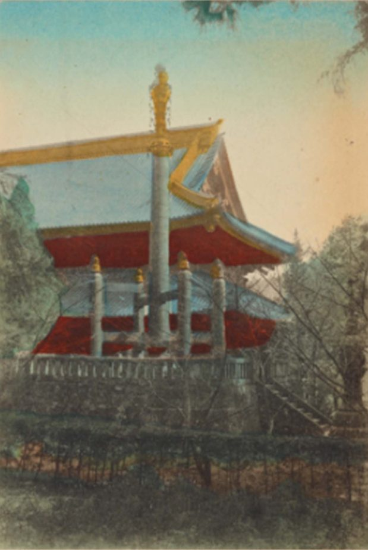
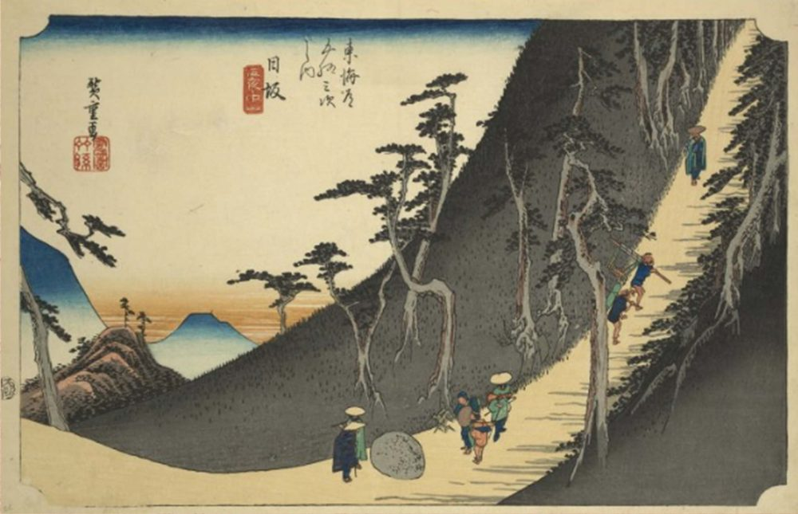

## Встреча с Бракованным Старцем

Встреча с Бракованным Старцем — трудное, но не невозможное дело. Она требует большого такта и осмотрительности. Бракованный Старец не враждебен к сыщикам и даже узнаёт их, если они были у *Идайны Синдзина*: он видел их его глазами. Бракованный Старец представится как *Кэккан-ноару Тан Бо* и будет невероятно извиняться перед сыщиками. *Кэккан-ноару Тан Бо* говорит с сыщиками как ребёнок и в конце каждой фразы извиняется. Он невероятно раскаивается в том, что невольно навлёк на *Идайну Синдзина*, и скажет сыщикам, что сделает что угодно, лишь бы ему помочь.

*Кэккан-ноару Тан Бо* не сможет сказать сыщикам, как *Идайна Синдзин* заболел и как его вылечить, — он честно этого не знает; успешная проверка ***Психологии*** это подтвердит. Если рассказать ему о плане Старцев Ямагути — убить *Кэккан-ноару Тан Бо* в обмен на исцеление *Идайны*, — он запаникует и закричит от отчаяния. Тогда он решит, что сыщики пришли его убить. Успокоить его можно, только бросив оружие или пройдя проверку ***Психологии*** либо ***Обаяния***.

Сам *Кэккан-ноару Тан Бо* не сможет найти выход — он слишком по-детски наивен и напуган. Выбор целиком за сыщиками, и у них четыре главных пути — каждый трудный и каждый с тяжелейшими последствиями.

## Бракованный Старец убит

Самый прямой и самый глупый из путей — кровавая бойня и для неразумных сыщиков, и для жалкого существа. Бой будет тяжёлым для обеих сторон, но если сыщики хладнокровно убьют *Кэккан-ноару Тан Бо*, его жизненная сила покинет и его, и тело *Идайны Синдзина* — однако страшной ценой. Старцы Ямагути, почувствовав, что психическая связь между *Идайной* и *Кэккан-ноару Тан Бо* оборвалась, остаются недовольны и бросают тело *Идайны*, как выбрасывают сопливый носовой платок. *Идайна* разрывается изнутри, это причиняет ему невыразимый вред: он чувствует, как его душа раскалывается надвое, и разум его рушится.

Того *Идайны Синдзина*, каким он был, того *Идайны Синдзина*, что писал стихи и собирал цветы, больше никогда не будет. Его находят в его комнате в «Чёрной утке»: сыпь исчезла, бред прекратился, но на их месте — совсем ничего. *Идайна* остаётся беспомощным калекой до конца жизни и больше никогда не сможет ни говорить, ни двигаться. Остаток жизни он проводит в библиотеке-монастыре Ямагути.

