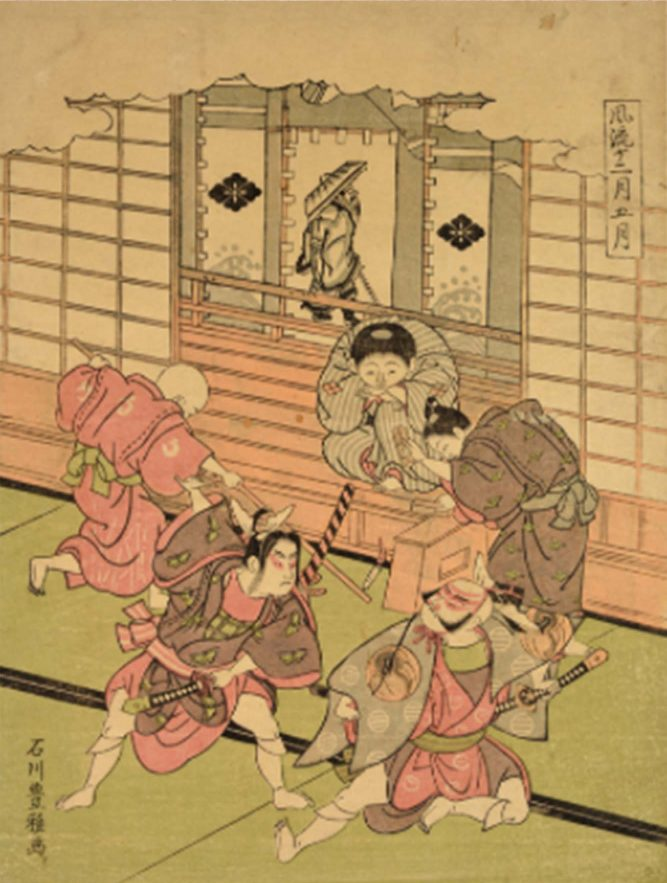

## Бракованный Старец жертвует собой

В награду за отличную отыгровку или после чрезвычайного успеха проверки ***Убеждения*** *Кэккан-ноару Тан Бо* можно убедить действительно пожертвовать собой ради *Идайны Синдзина*: он поймёт, что во всём этом виноват он сам, и примет на себя всю ответственность, зная, что должен умереть, чтобы его любимый поэт жил. Как именно доставить его к святилищу на горе Сёдзидакэ — решают сыщики; но, когда они туда придут, появится один из Старцев Ямагути и уведёт *Кэккан-ноару Тан Бо* в их логово, чтобы убить так, как они сочтут нужным. На этом сыщики останутся на горе, глядя на весь город Ямагути и размышляя о том, что они сделали. На следующий день *Идайна* проснётся исцелённым от сыпи, не помня последних нескольких недель, — будто с ним не случилось ничего, кроме долгого сна; всё это покажется ему сном.

## Старец не убит: смерть Идайны

Объективно худший исход для всех, кроме Старцев Ямагути; к нему придут лишь самые невнимательные или самые жестокие сыщики. Сыщикам может показаться, что оставить *Кэккан-ноару Тан Бо* в живых — милосердие к нему, но всё как раз наоборот. Если *Идайну* не исцелить, сыпь продолжит свой жуткий отсчёт, и на 0 *Идайну Синдзина* начнёт трясти и бить в судорогах. Сыпь проедает ему грудь. Куски его тела с мерзким хлюпаньем падают на пол. *Кэккан-ноару Тан Бо* видит это изнутри самого *Идайны* и всеми силами пытается вселиться в него, чтобы спасти, — но бесполезно. Кэккан-ноару Тан Бо смотрит, как сыпь превращает *Идайну* в слизь, а мозг вырывается у него из головы — последнее рассечение души. От *Идайны* остаются лишь голова, искажённая гримасой муки, и зелёно-красное пятно на полу театра кабуки «Чёрная утка». Лишившись смысла жизни, увидев, как у него на глазах так погиб его любимый человек, *Кэккан-ноару Тан Бо* бросается в реку Фусино и топится — у Старца на это уходят часы. Его тело уносит в океан, и больше его увидят лишь чайки и рыбы, пирующие на его трупе. От *Кэккан-ноару Тан Бо* остаются лишь 49 странных когтей, плавающих где-то в Тихом океане.

## Идайну исцеляет заклинание онмёдзи

Этот исход можно назвать хорошим. Здесь вообще никто не умирает, а Старцы Ямагути терпят неудачу в попытках управлять людьми ради своей мерзкой выгоды. Если сыщики оставят *Кэккан-ноару Тан Бо* в покое, у них ещё есть возможность исцелить Идайну Синдзина — если они дали *Курои Роху* достаточно времени закончить заклинание. Если заклинание на Идайну сотворено успешно, каждая шершавая чешуйка его кожи встаёт дыбом и отрывается; и когда разрывается телесный символ психической связи между ним и Старцами Ямагути, разрывается и сама связь. *Идайна* полностью исцелён; хотя на то, чтобы оправиться от всего пережитого, у него уйдёт около недели, он очень скоро сможет вернуться к своему обычному делу — писать стихи, на радость литературному миру Японии. И пока Старцы Ямагути грозят несуществующими кулаками обезьянам-обманщикам, сорвавшим их план, *Кэккан-ноару Тан Бо* усваивает урок: не вмешиваться в жизнь людей, которыми восхищается; до конца жизни он будет наблюдать за людьми издалека — и навсегда останется главным поклонником *Идайны Синдзина*.

## Заключение

Чем бы ни закончилось это приключение для сыщиков, они его точно не забудут. Наконец они получили подтверждение, что ёкаи из легенд реальны, а если решатся сложить все кусочки вместе, то, быть может, поймут, что это не просто ёкаи. Пережили ли они трагическую историю о личной одержимости отверженного пришельца, обернувшейся бедой, или чудовищную историю о демонических духах, сделавших бедного поэта посредником в своей распре, — сыщики нашли свой выход. Или нет. Пожалуй, сыщикам пора покинуть густые леса Ямагути и отправиться куда-нибудь, где просторнее и намного светлее. Кое-кто из сыщиков слышал, что на Танэгасиме в это время года хорошо, — и какое совпадение: *Ямагути Хого* едет туда на похороны, и сыщикам стоило бы поехать с ним. Что может пойти не так?

## Награды

| Исход | Рассудок |
|---|---|
| *Идайна Синдзин* невредим и исцелён от своего недуга | +1d4 |
| *Донёкуна Тэ* утешен | +1d4 |
| Сыщики убедили Бракованного Старца убить себя | +1d6 |
| Тело Бракованного Старца отдано на горе Сёдзидакэ | +1d6 |
| Сыщики жестоко убили Бракованного Старца | −1d4 |
| *Идайну Синдзина* убили Старцы в конце отсчёта | −1d6 |
| *Идайна Синдзин* стал калекой | −1d4 |
| Бракованный Старец оставлен в живых | −1d6 |
| Сыщики не спасли *Курои Роху* | −1d4 |
