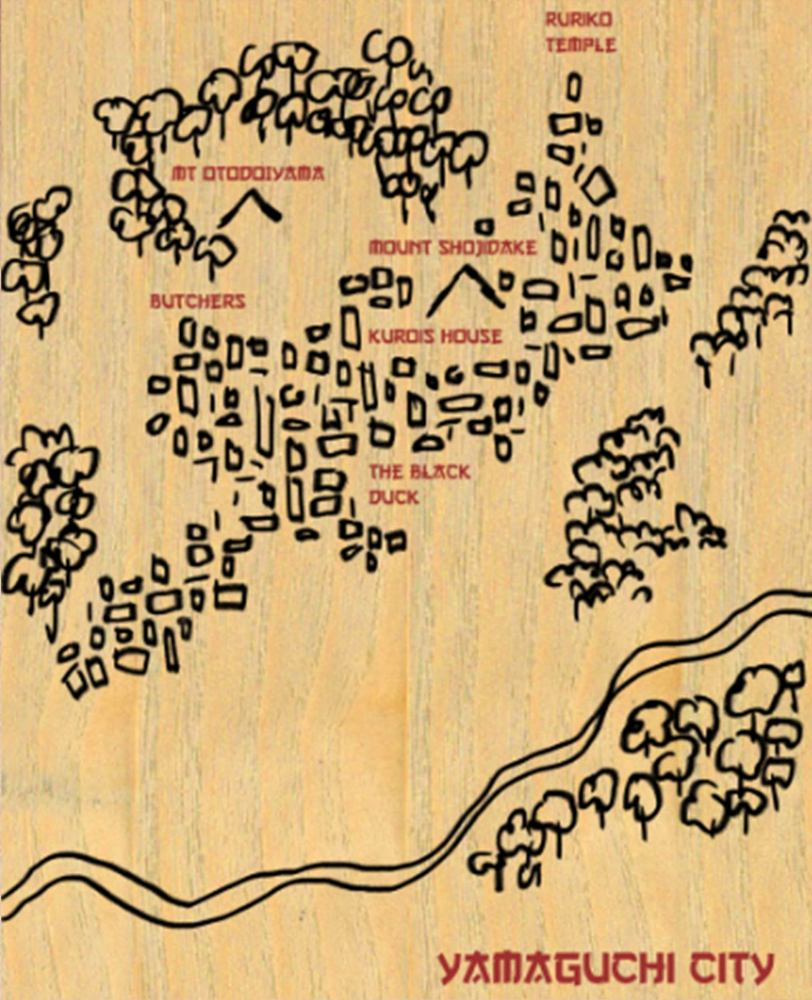
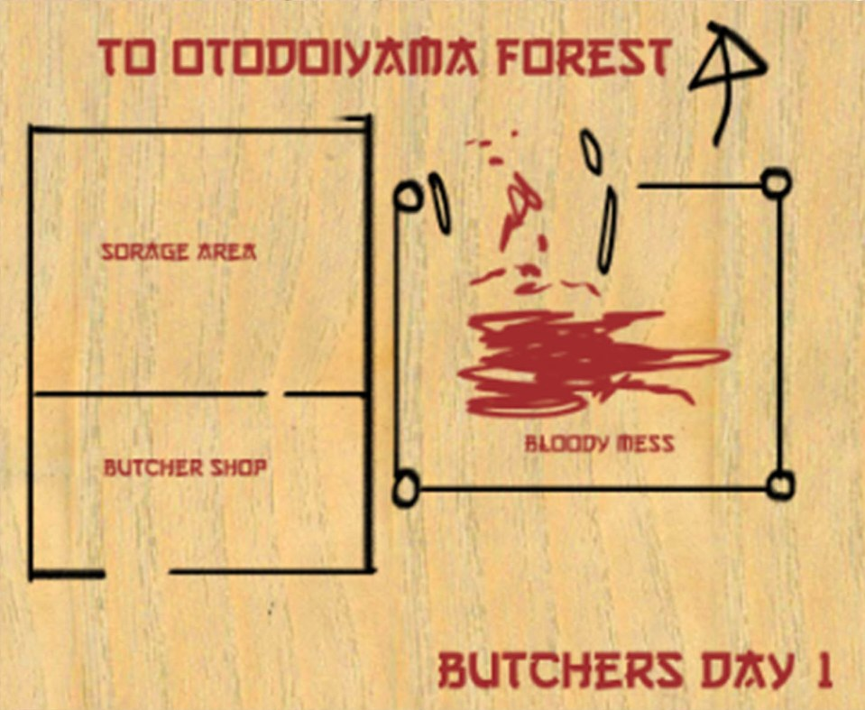
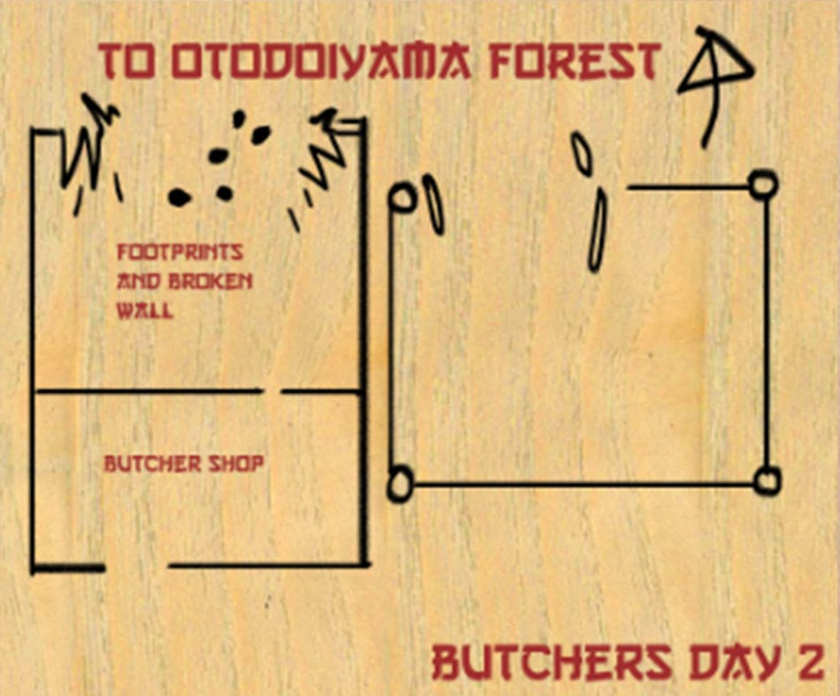

# Приложение D: карты

## Город Ямагути

*Надписи на карте:* Ruriko temple — храм Рурикодзи; Mt Otodoiyama — гора Отодоияма; Mount Shojidake — гора Сёдзидакэ; Butchers — лавка мясника; Kuroi’s house — дом Курои; The Black Duck — «Чёрная утка»; Yamaguchi city — город Ямагути. Внизу — река (Фусино), по краям — леса.

## Лавка мясника, день первый

*Надписи на карте:* To Otodoiyama forest — к лесу Отодоияма; Sorage area — кладовая; Butcher shop — лавка мясника; Bloody mess — кровавое месиво (в загоне); Butchers day 1 — лавка мясника, день первый.

## Лавка мясника, день второй

*Надписи на карте:* To Otodoiyama forest — к лесу Отодоияма; Footprints and broken wall — следы и проломленная стена; Butcher shop — лавка мясника; Butchers day 2 — лавка мясника, день второй.

*Прим. перев.: на карте опечатка «Sorage area» (вместо «Storage area») и «Ruriko temple» (храм Рурикодзи).*
