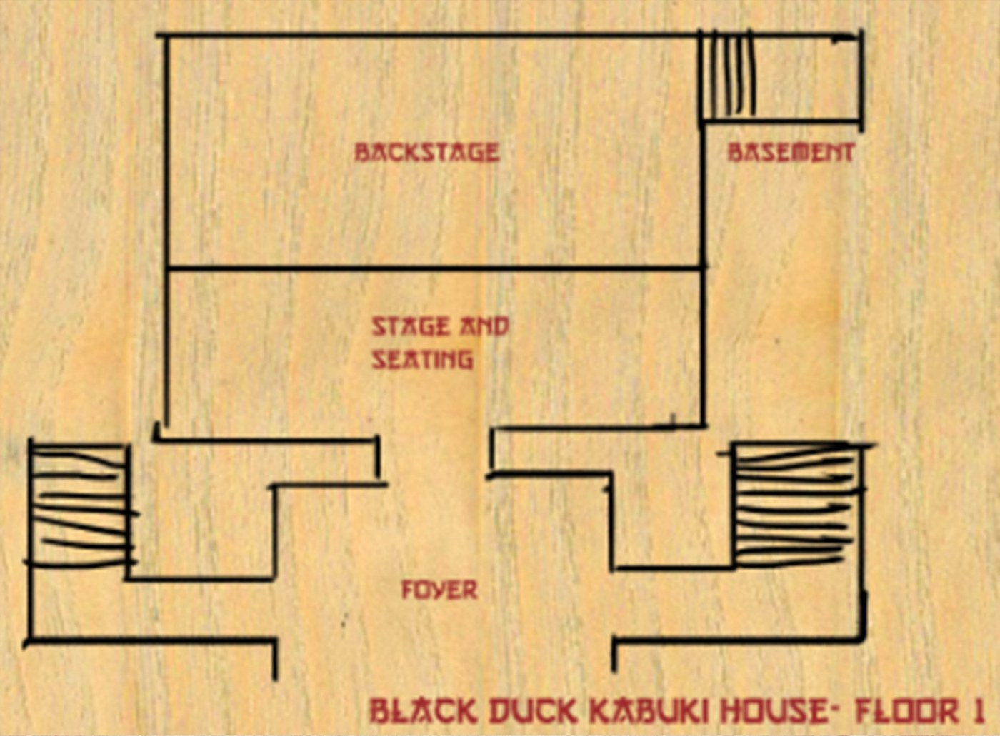
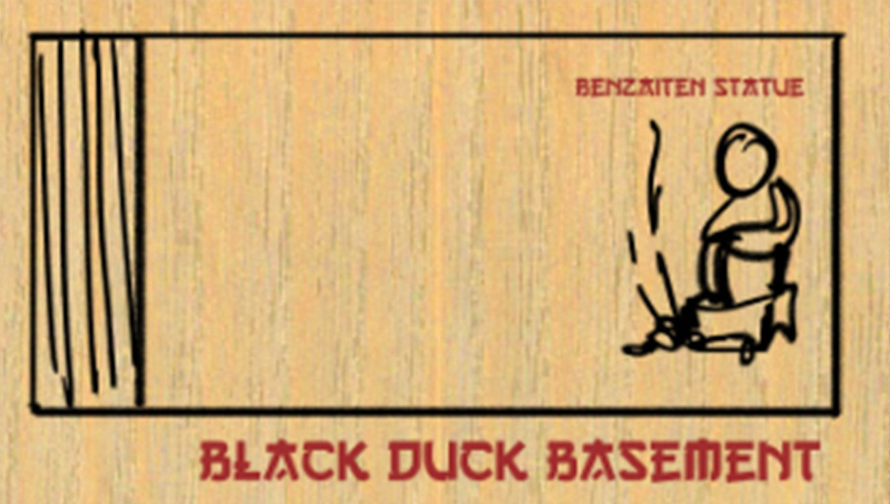

## Театр кабуки «Чёрная утка», первый этаж

*Надписи на карте:* Backstage — закулисье; Basement — подвал (лестница вниз); Stage and seating — сцена и зрительный зал; Foyer — фойе (по бокам — лестницы на второй этаж); Black Duck Kabuki house — floor 1 — театр кабуки «Чёрная утка», первый этаж.

## Подвал «Чёрной утки»

*Надписи на карте:* Benzaiten statue — статуя Бэндзайтэн; Black Duck basement — подвал «Чёрной утки». Слева — лестница из закулисья.
