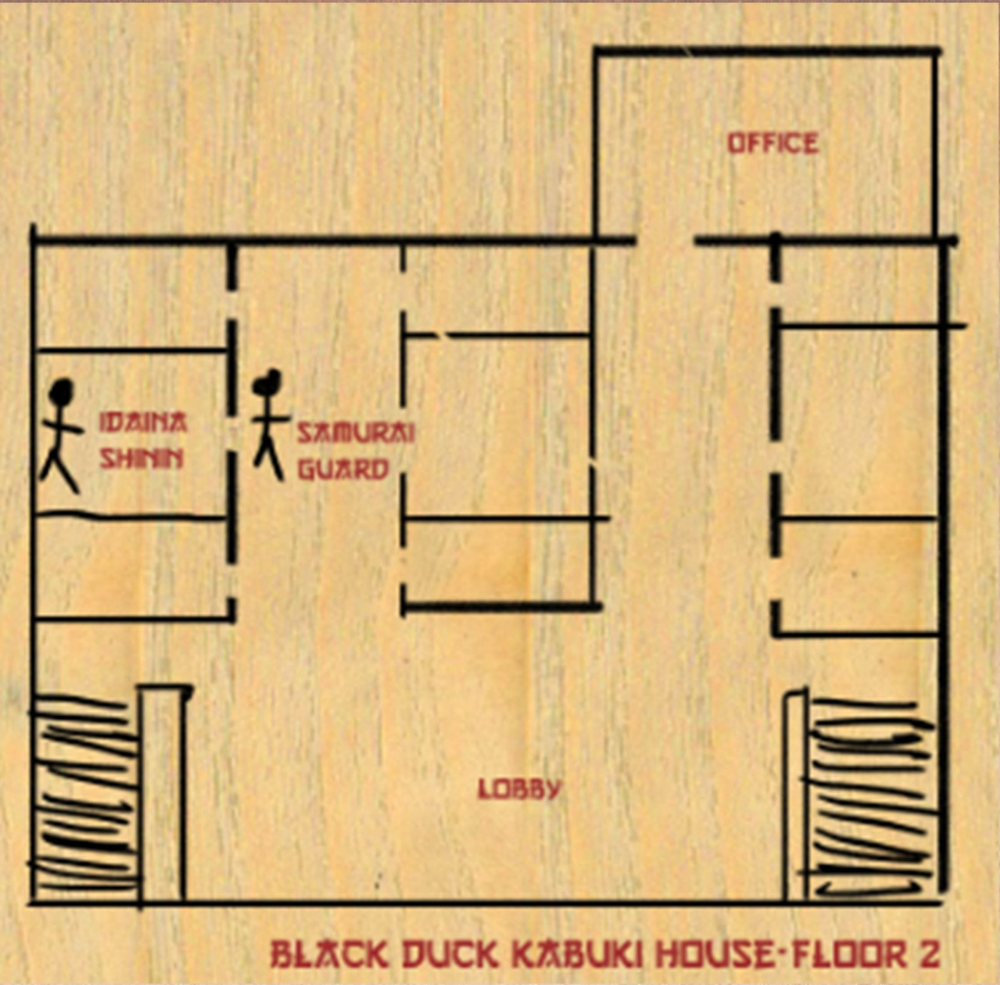
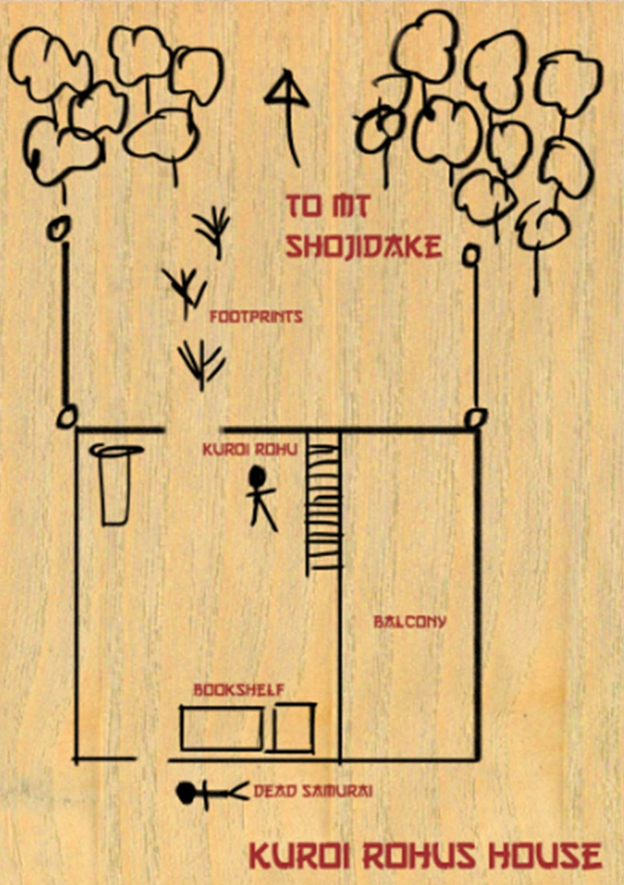

## Театр кабуки «Чёрная утка», второй этаж

*Надписи на карте:* Office — кабинет (Гэйдзюцу Тэки); Idaina Shinin — Идайна Синдзин (в его комнате); Samurai guard — самурай-стражник; Lobby — общий зал (по бокам — лестницы); Black Duck Kabuki house — floor 2 — театр кабуки «Чёрная утка», второй этаж.

*Прим. перев.: на карте имя поэта напечатано «Shinin»; кабинет нарисован на этом, втором, этаже, хотя в тексте (с. 5) он — единственная комната третьего этажа.*

## Дом Курои Роху

*Надписи на карте:* To Mt Shojidake — к горе Сёдзидакэ (стрелка, за деревьями); Footprints — следы; Kuroi Rohu — Курои Роху; Balcony — балкон (с лестницей); Bookshelf — книжная полка; Dead samurai — мёртвый самурай; Kuroi Rohus house — дом Курои Роху.
