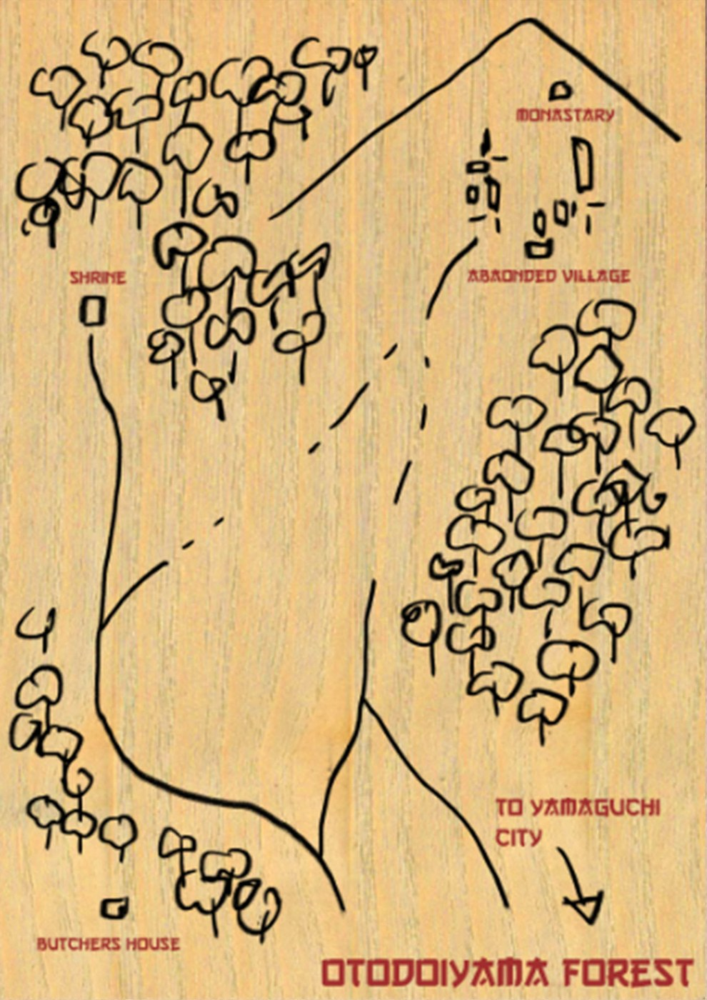
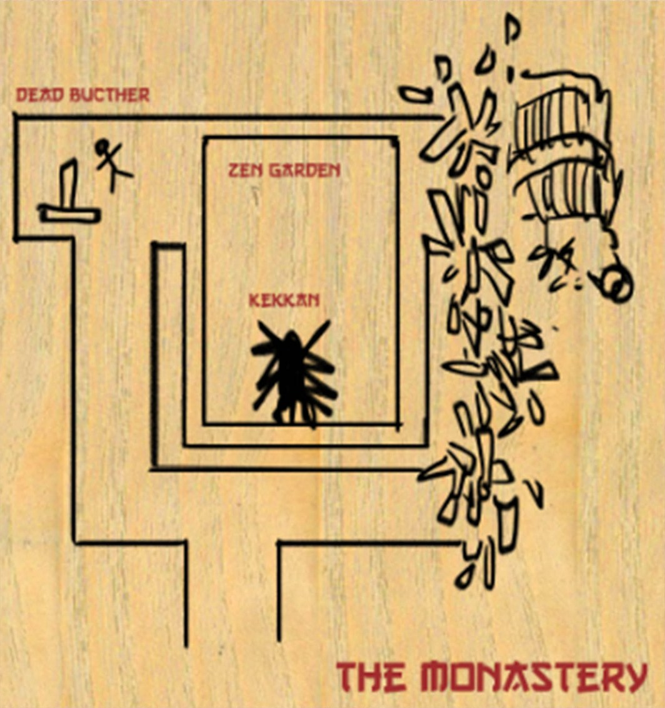

## Лес Отодоияма

*Надписи на карте:* Monastary — монастырь (на склоне горы); Abanonded village — заброшенная деревня; Shrine — святилище (на развилке); To Yamaguchi city — к городу Ямагути; Butchers house — дом мясника; Otodoiyama forest — лес Отодоияма.

## Разрушенный монастырь

*Надписи на карте:* Dead bucther — мёртвый мясник (в фонтане); Zen garden — сад камней; Kekkan — Кэккан-ноару Тан Бо; The monastery — монастырь. Справа — обрушенная часть.

*Прим. перев.: на картах опечатки — «Monastary», «Abanonded village», «Dead bucther».*
