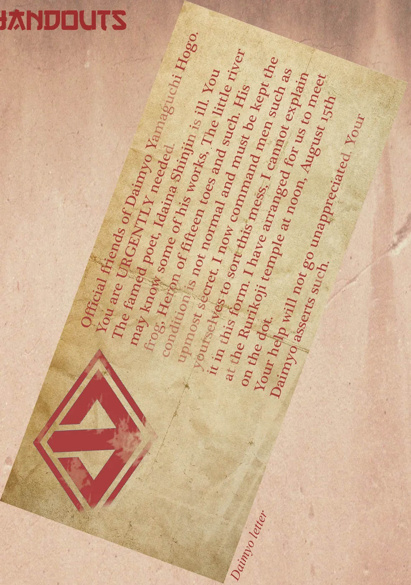

# Приложение D: раздатки

*Прим. перев.: в книге два приложения «D» — карты и раздатки. Ниже — каждая раздатка в оригинале (картинкой, для печати) и её перевод.*

## Письмо даймё

> **Раздатка «Письмо даймё»**
>
> Официальным друзьям даймё Ямагути Хого.
>
> Вы СРОЧНО нужны.
>
> Прославленный поэт Идайна Синдзин болен. Возможно, вам знакомы его стихи — «Речная лягушка», «Цапля о пятнадцати пальцах» и прочие. Его состояние ненормально и должно храниться в глубочайшей тайне. Я повелеваю таким людям, как вы, разобраться в этом деле; объяснить его в письме я не могу. Я устроил так, чтобы мы встретились у храма Рурикодзи в полдень 15 августа, минута в минуту.
>
> Ваша помощь не останется без награды. Так заверяет ваш даймё.
>
> [слева — красная печать-ромб]
