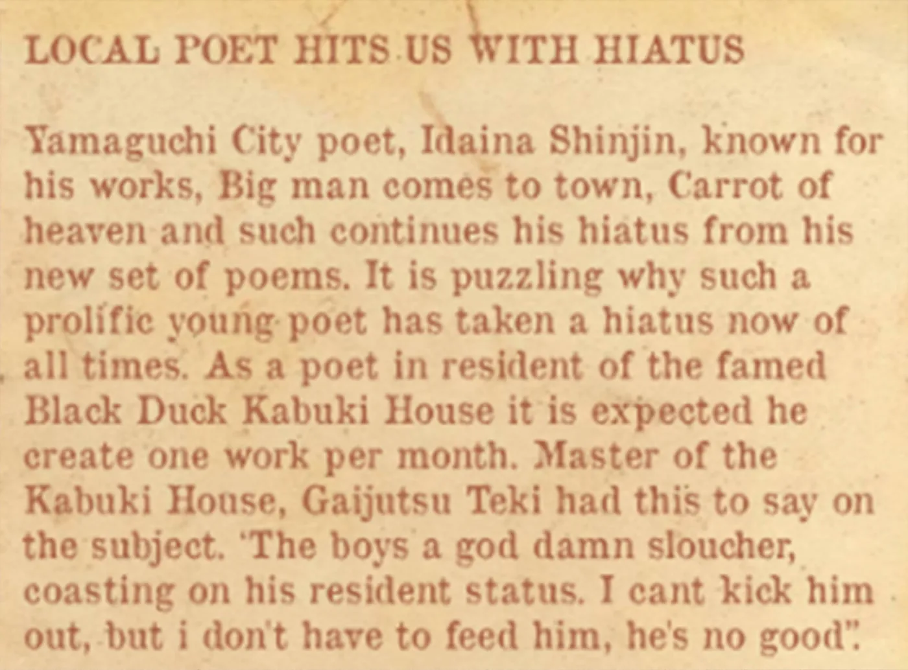
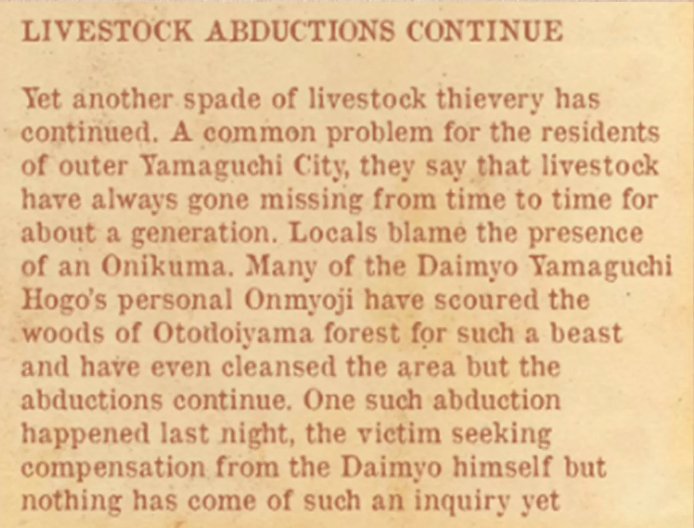

## Газета, день 1: о поэте

> **Раздатка «Газета, день 1: „Местный поэт огорошил нас перерывом“»**
>
> **МЕСТНЫЙ ПОЭТ ОГОРОШИЛ НАС ПЕРЕРЫВОМ**
>
> Поэт города Ямагути Идайна Синдзин, известный своими сочинениями «Большой человек приезжает в город», «Морковь небес» и прочими, продолжает перерыв в работе над новым циклом стихов. Непонятно, почему такой плодовитый молодой поэт взял перерыв именно сейчас. Как поэт при прославленном театре кабуки «Чёрная утка», он обязан создавать одно произведение в месяц. Хозяин театра Гэйдзюцу Тэки высказался по этому поводу так: «Парень — проклятый бездельник, катается на своём положении резидента. Выгнать его я не могу, но кормить его я не обязан, толку от него никакого».

<!-- -->

## Газета, день 1: о краже скота

> **Раздатка «Газета, день 1: „Кража скота продолжается“»**
>
> **КРАЖА СКОТА ПРОДОЛЖАЕТСЯ**
>
> Снова продолжилась череда краж скота. Это давняя беда жителей окраин города Ямагути: по их словам, скот время от времени пропадает уже около поколения. Местные винят в этом оникуму. Немало личных онмёдзи даймё Ямагути Хого прочёсывали леса Отодоияма в поисках такого зверя и даже очистили местность, но кражи продолжаются. Одна из них случилась прошлой ночью; пострадавший требует возмещения от самого даймё, но пока его прошение ни к чему не привело.

*Прим. перев.: в первой заметке имя хозяина театра напечатано «Gaijutsu».*
