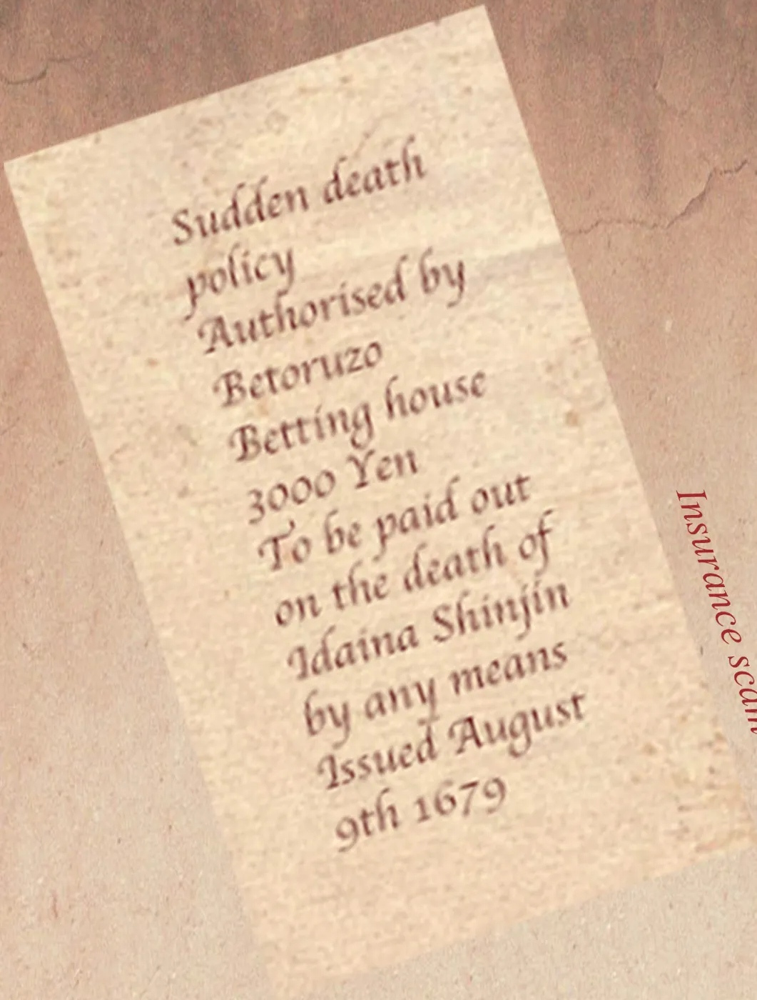
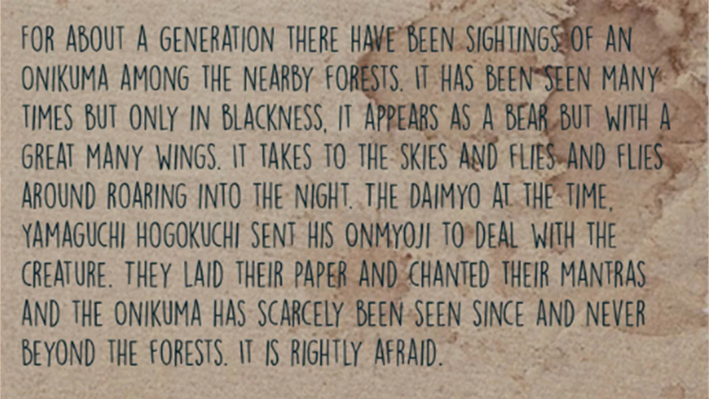

## Страховой полис

> **Раздатка «Страховой полис»**
>
> Полис на случай внезапной смерти
>
> Выдан игорным домом «Беторозу»
>
> 3000 иен
>
> К выплате после смерти Идайны Синдзина, от чего бы то ни было.
>
> Выдан 9 августа 1679 года

<!-- -->

*Прим. перев.: на раздатке — 3000 иен, а в тексте (с. 5) полис на 10 000 иен; название игорного дома напечатано «Betoruzo».*

## Рассказ о летающем медведе

> **Раздатка «Рассказ о летающем медведе»**
>
> Уже около поколения в окрестных лесах видят оникуму. Её видели не однажды, но только во тьме: она похожа на медведя, но с огромным множеством крыльев. Она взмывает в небо и летает, летает вокруг, ревя в ночи. Тогдашний даймё Ямагути Хогокути послал своих онмёдзи разделаться с тварью. Они разложили свои бумаги и пропели свои мантры, и с тех пор оникуму почти не видели, а за пределами лесов — никогда. Она боится, и поделом.
