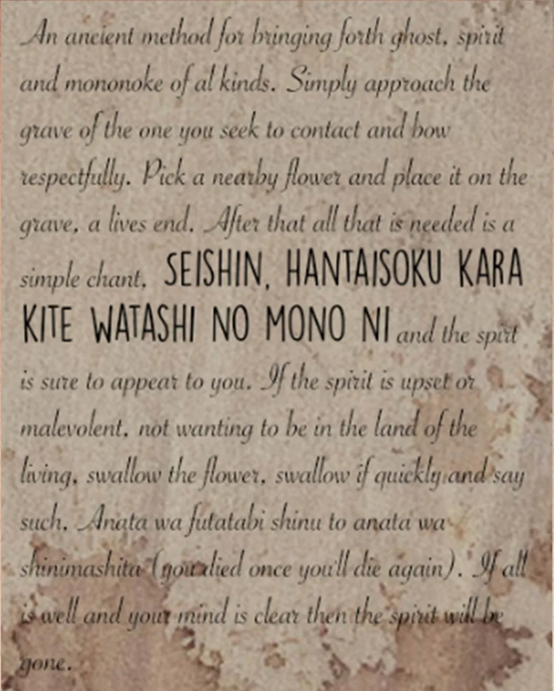
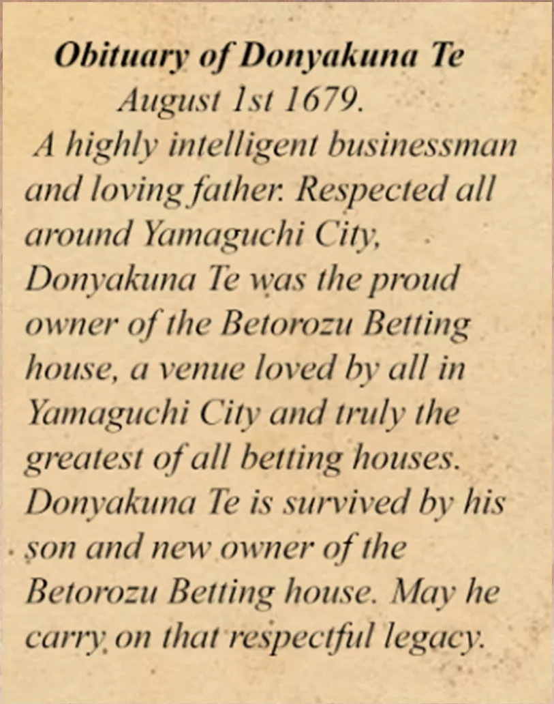
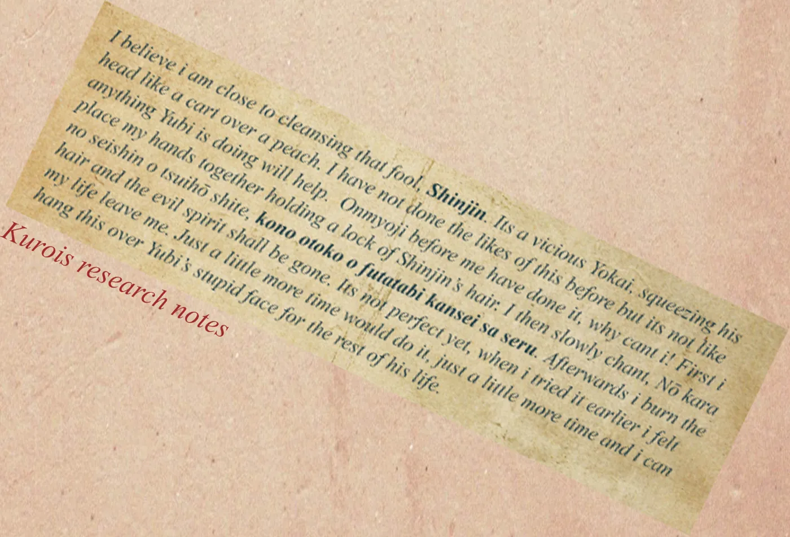

## Заклинание изгнания духа

> **Раздатка «Заклинание изгнания духа»**
>
> Древний способ вызвать призрака, духа и мононокэ любого рода. Просто подойдите к могиле того, с кем хотите связаться, и почтительно поклонитесь. Сорвите цветок поблизости и положите его на могилу — конец жизни. После этого нужно лишь простое песнопение: СЭЙСИН, ХАНТАИСОКУ КАРА КИТЭ ВАТАСИ НО МОНО НИ — и дух непременно явится вам. Если дух расстроен или зол и не хочет быть в мире живых, проглотите цветок, проглотите его быстро и скажите так: Аната ва футатаби сину то аната ва синимасита (ты умер однажды — умрёшь и снова). Если всё хорошо и ваш разум ясен, дух исчезнет.

<!-- -->

## Некролог

> **Раздатка «Некролог Донёкуны Тэ»**
>
> **Некролог Донёкуны Тэ**
>
> 1 августа 1679 года.
>
> Высокоумный делец и любящий отец. Уважаемый всеми в городе Ямагути, Донёкуна Тэ был гордым владельцем игорного дома «Беторозу» — заведения, любимого всеми в городе Ямагути, и поистине величайшего из всех игорных домов. Донёкуну Тэ пережил его сын, новый владелец игорного дома «Беторозу». Да продолжит он это почтенное наследие.

<!-- -->

## Записи Курои

> **Раздатка «Записи Курои»**
>
> Думаю, я близок к тому, чтобы очистить этого дурака, Синдзина. Это злобный ёкай, он сдавливает ему голову, как телега персик. Такого я ещё не делал, но уж точно ничто из того, что делает Юби, не поможет. Онмёдзи до меня это делали — почему же я не могу! Сначала я складываю ладони, держа прядь волос Синдзина. Потом медленно пою: Но кара но сэйсин о цуйхо ситэ, коно отоко о футатаби кансэй са сэру. Потом сжигаю волосы, и злой дух уйдёт. Пока не идеально: когда я пробовал раньше, я почувствовал, как из меня уходит жизнь. Ещё немного времени — и всё получится, совсем немного времени, и я смогу тыкать этим в глупую физиономию Юби до конца его жизни.

*Прим. перев.: в некрологе имя напечатано «Donyakuna»; подпись под записями — «Kurois research notes».*
