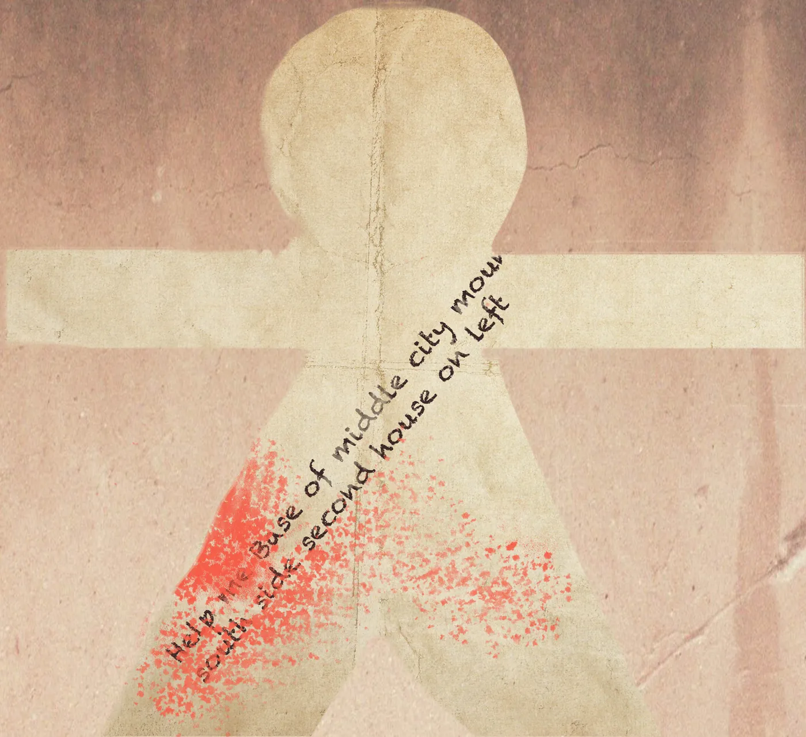
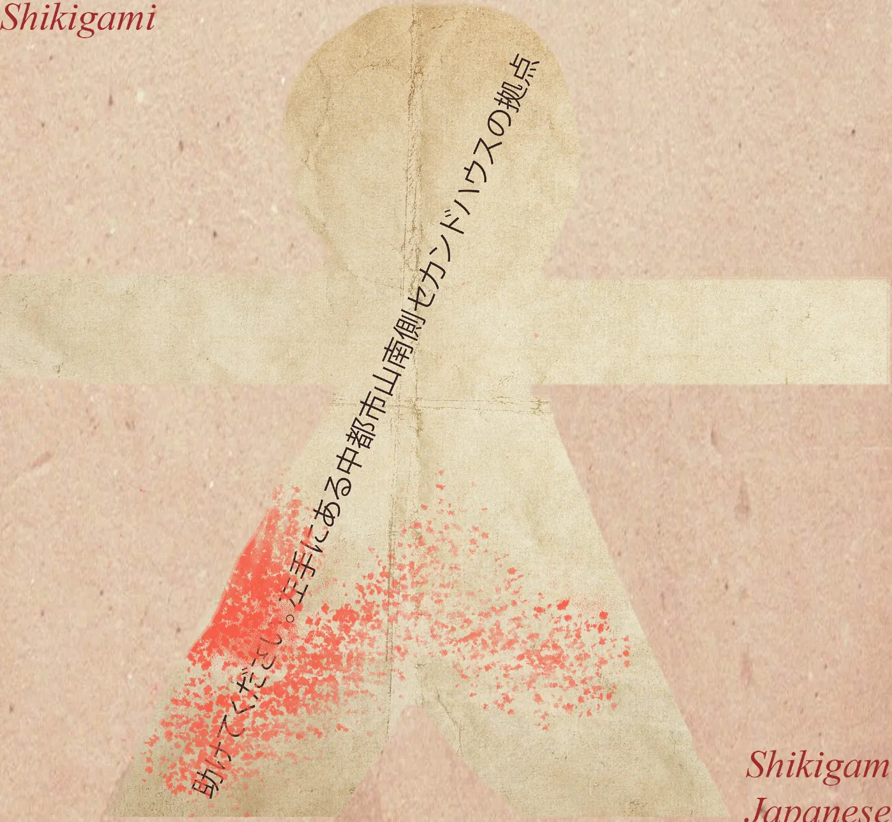

## Сикигами

> **Раздатка «Сикигами» (английский вариант)**
>
> [надпись на бумажной кукле, забрызганной красным]
>
> Помогите мне! Подножие горы посреди города, южная сторона, второй дом слева.

<!-- -->

## Сикигами — японский вариант

> **Раздатка «Сикигами» (японский вариант)**
>
> 助けてください。左手にある中都市山南側セカンドハウスの拠点
>
> [тот же призыв по-японски: «Помогите! …город, гора, южная сторона, второй дом, слева»]

*Прим. перев.: в книге подпись — «Shikigam- Japanese»; английский текст на кукле — «Help me Base of middle city mountain south side second house on left».*
