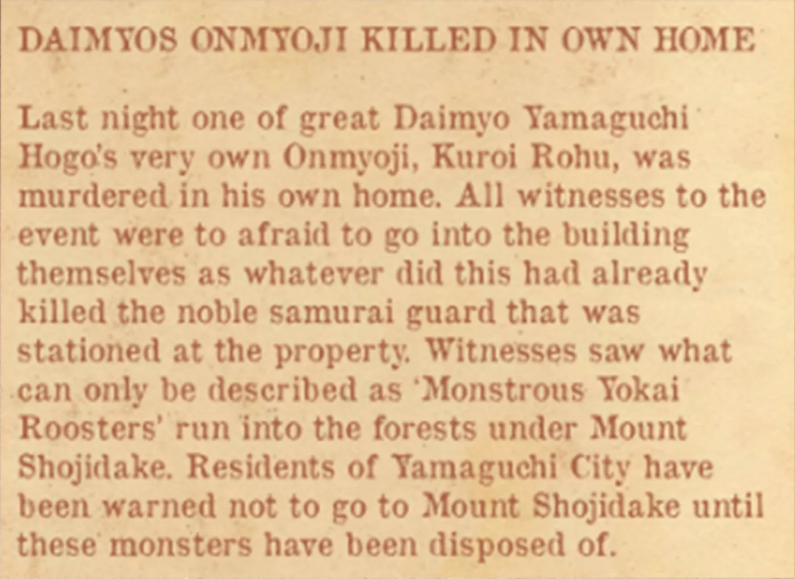
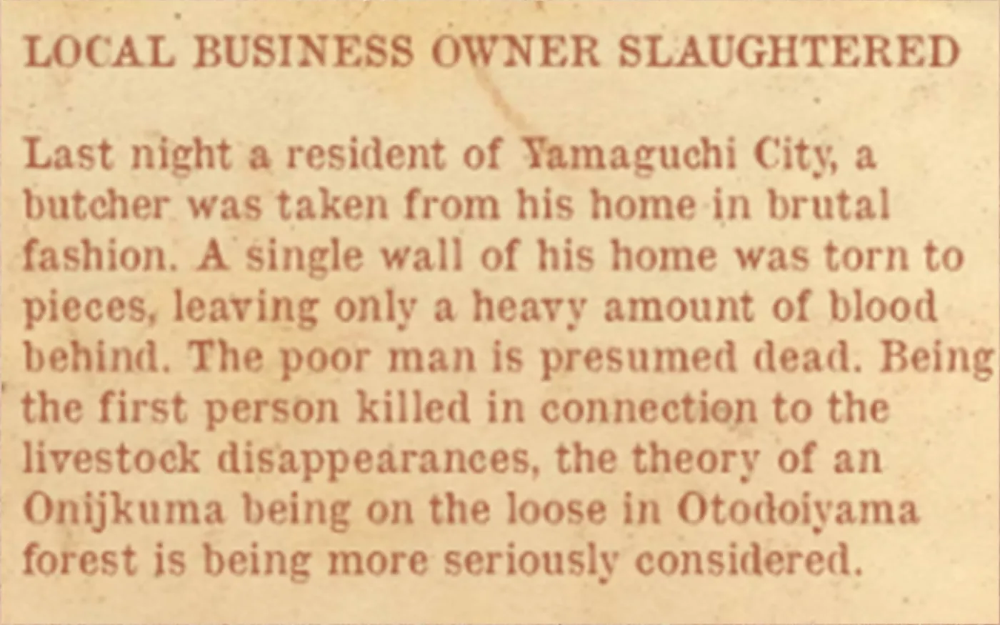

## Газета, день 2: об убитом онмёдзи

> **Раздатка «Газета, день 2: „Онмёдзи даймё убит в собственном доме“»**
>
> **ОНМЁДЗИ ДАЙМЁ УБИТ В СОБСТВЕННОМ ДОМЕ**
>
> Прошлой ночью один из личных онмёдзи великого даймё Ямагути Хого, Курои Роху, был убит в собственном доме. Все свидетели слишком боялись сами войти в дом: то, что это сделало, уже убило благородного самурая, стоявшего на страже. Свидетели видели, как нечто, что можно описать лишь как «чудовищных петухов-ёкаев», убежало в леса под горой Сёдзидакэ. Жителей города Ямагути предупредили не ходить на гору Сёдзидакэ, пока с этими чудовищами не покончат.

<!-- -->

## Газета, день 2: о погибшем мяснике

> **Раздатка «Газета, день 2: „Местный предприниматель растерзан“»**
>
> **МЕСТНЫЙ ПРЕДПРИНИМАТЕЛЬ РАСТЕРЗАН**
>
> Прошлой ночью житель города Ямагути, мясник, был жестоко похищен из собственного дома. Одна стена его дома разнесена в клочья, остался лишь большой след крови. Бедняга считается погибшим. Поскольку это первый человек, погибший в связи с пропажами скота, версию о том, что в лесу Отодоияма бесчинствует оникума, теперь рассматривают куда серьёзнее.

*Прим. перев.: во второй заметке напечатано «Onijkuma» (оникума); подпись — «Newsppaer dead butcher day 2».*
