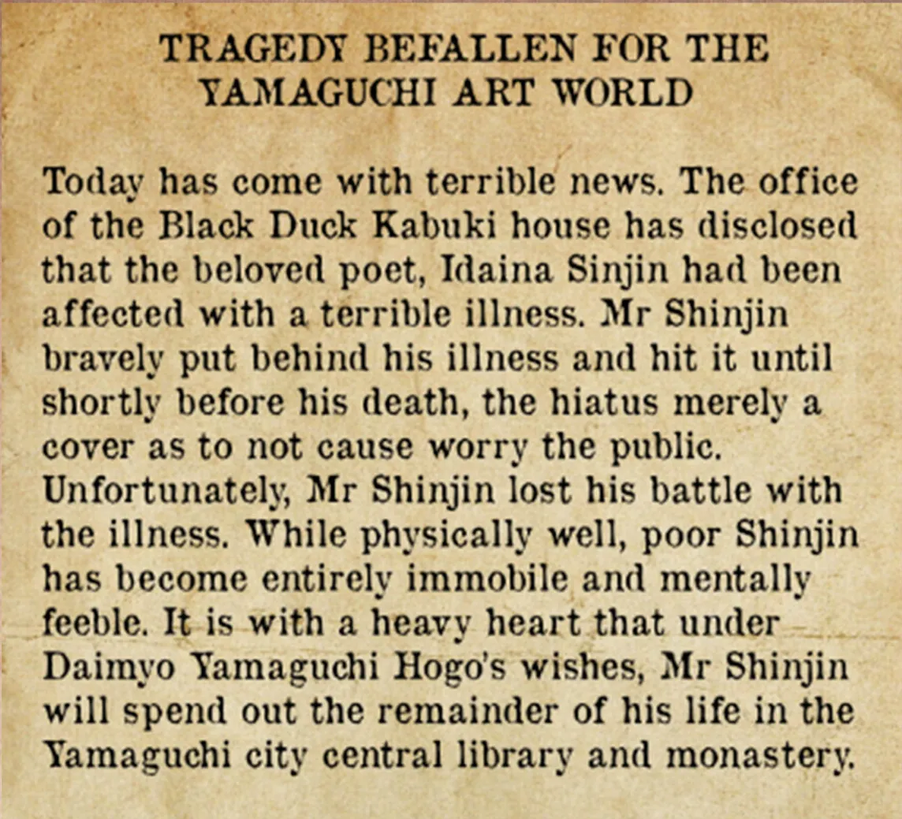
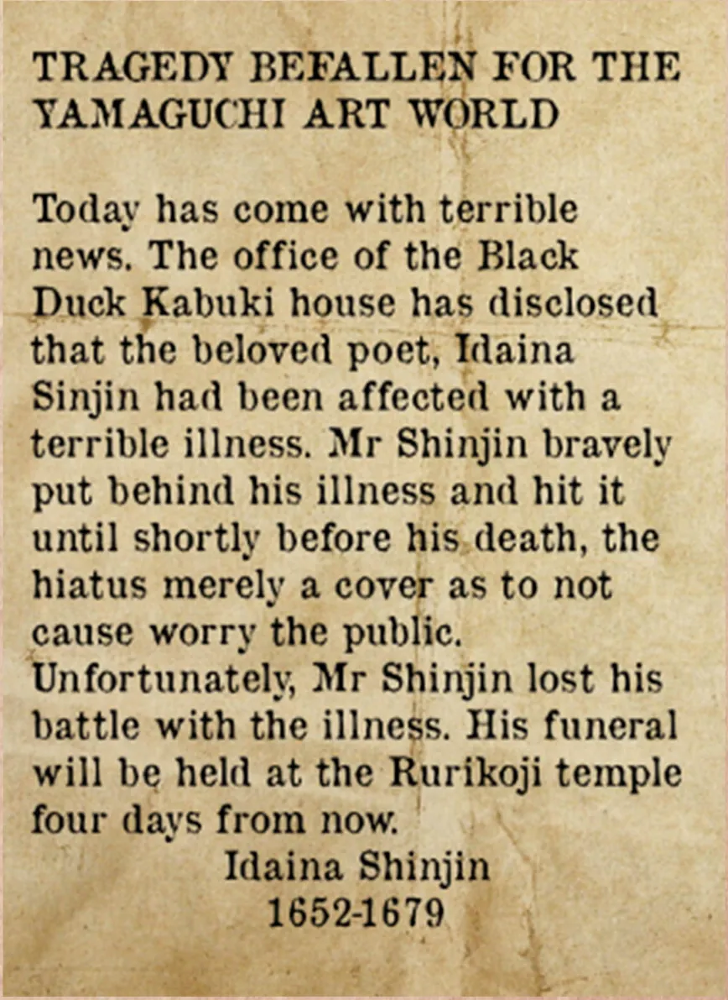

## Газета: Идайна Синдзин изменился навсегда

> **Раздатка «Газета: Идайна Синдзин изменился навсегда»**
>
> **ТРАГЕДИЯ ПОСТИГЛА МИР ИСКУССТВА ЯМАГУТИ**
>
> Сегодняшний день принёс ужасную весть. Контора театра кабуки «Чёрная утка» сообщила, что любимый поэт Идайна Синдзин был поражён страшным недугом. Господин Синдзин мужественно не подавал виду и скрывал болезнь почти до самой смерти; перерыв в работе был лишь прикрытием, чтобы не тревожить публику. К несчастью, господин Синдзин проиграл битву с болезнью. Телесно он здоров, но бедный Синдзин совершенно обездвижен и слаб рассудком. С тяжёлым сердцем сообщаем, что по воле даймё Ямагути Хого господин Синдзин проведёт остаток жизни в центральной библиотеке и монастыре города Ямагути.

<!-- -->

## Газета: Идайна Синдзин исцелён

> **Раздатка «Газета: Идайна Синдзин исцелён»**
>
> **ТРАГЕДИЯ ПОСТИГЛА МИР ИСКУССТВА ЯМАГУТИ**
>
> Сегодняшний день принёс ужасную весть. Контора театра кабуки «Чёрная утка» сообщила, что любимый поэт Идайна Синдзин был поражён страшным недугом. Господин Синдзин мужественно не подавал виду и скрывал болезнь почти до самой смерти; перерыв в работе был лишь прикрытием, чтобы не тревожить публику. К несчастью, господин Синдзин проиграл битву с болезнью. Телесно он здоров, но бедный Синдзин совершенно обездвижен и слаб рассудком. С тяжёлым сердцем сообщаем, что по воле даймё Ямагути Хого господин Синдзин проведёт остаток жизни в центральной библиотеке и монастыре города Ямагути.

*Прим. перев.: под подписью «Newspaper Idaina Shinjin is cured» напечатан тот же текст, что и в заметке «изменился навсегда» (о поэте-калеке); своей заметки об исцелении в книге нет. При исцелении Идайны эту раздатку лучше не выдавать.*

## Газета: Идайна Синдзин погиб

> **Раздатка «Газета: Идайна Синдзин погиб»**
>
> **ТРАГЕДИЯ ПОСТИГЛА МИР ИСКУССТВА ЯМАГУТИ**
>
> Сегодняшний день принёс ужасную весть. Контора театра кабуки «Чёрная утка» сообщила, что любимый поэт Идайна Синдзин был поражён страшным недугом. Господин Синдзин мужественно не подавал виду и скрывал болезнь почти до самой смерти; перерыв в работе был лишь прикрытием, чтобы не тревожить публику. К несчастью, господин Синдзин проиграл битву с болезнью. Его похороны пройдут в храме Рурикодзи через четыре дня.
>
> Идайна Синдзин
>
> 1652–1679
