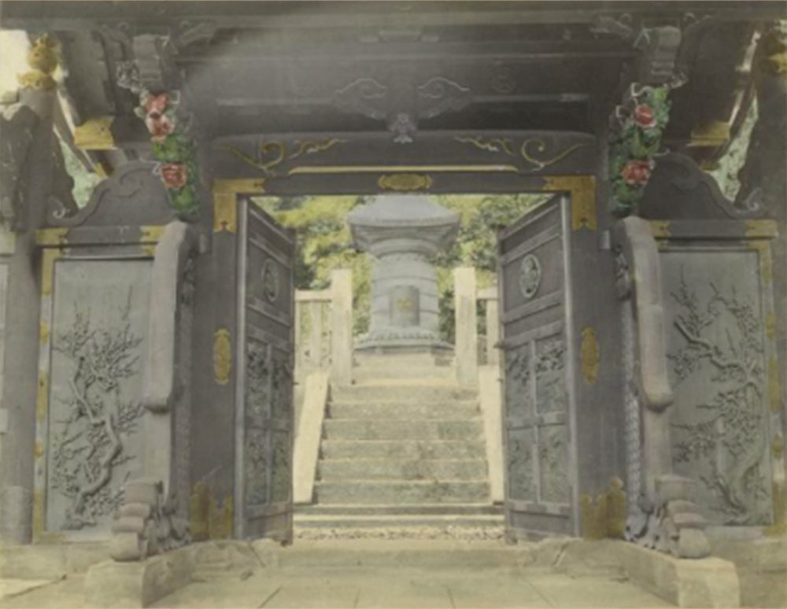

# Приключение продолжится на острове Танэгасима

**«Кофун закрывается на западе»** (The Kofun closes to the west)

**Скоро…**

*Прим. перев.: анонс второй главы задуманной кампании; она так и не вышла. Кофун — древний японский курган-гробница.*
