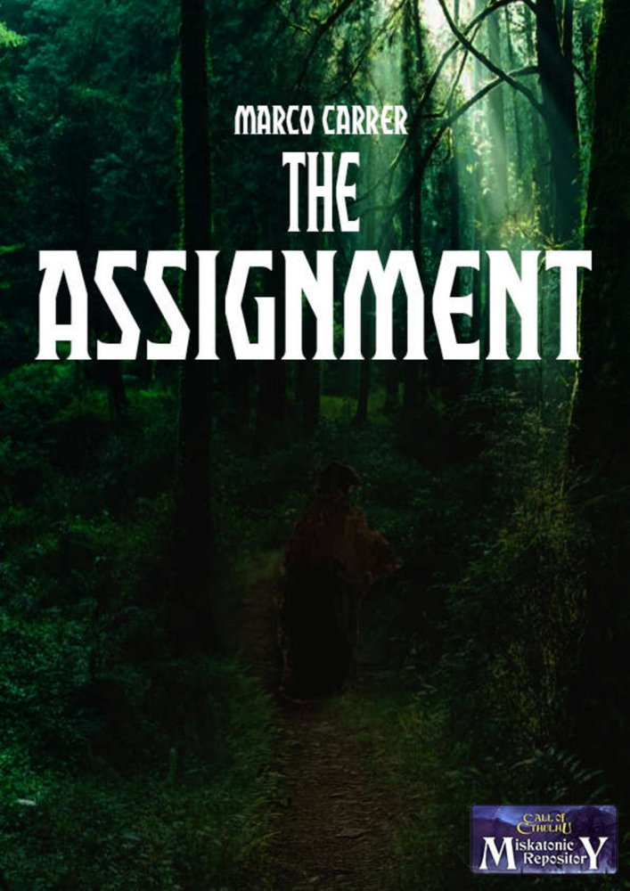

ПОРУЧЕНИЕ

Марко Каррер

*На обложке — тёмный лес, сквозь кроны пробивается свет; по тропе уходит фигура в плаще. Вверху — имя автора (Marco Carrer) и название «The Assignment»; внизу справа — логотип «Call of Cthulhu — Miskatonic Repository».*
