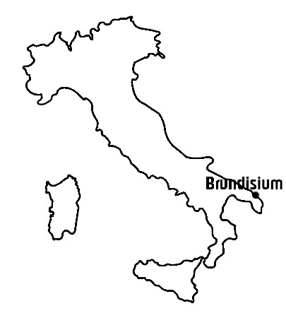

# Введение

Этот сценарий рассчитан на одного игрока и одного Хранителя.

# Информация для Хранителя

Игрок играет Фения, искателя. Однажды его патрон, Цезон Нераций, зовёт его к себе. Две ночи назад у Цезона кое-что украли, и игроку поручат это найти. Украден пергамент, который Цезон изучал. Его похитила женщина — стрикс в человеческом облике. В пергаменте описан способ призвать Шантака в наш мир. Стрикс хочет стать супругой Шантака и править вместе с ним.

Сценарий можно включить и в кампанию, действие которой происходит в Италии во времена Римской империи (город можно сменить, но не страну). Если игрок успешно выполнит поручение, концовка оставлена открытой для новых приключений.

## Новые навыки

Поскольку действие происходит в определённую эпоху, у персонажей есть навыки, которых нет в других обстановках. Сведения об этих новых навыках — на с. 10 книги «Cthulhu Through the Ages» издательства Chaosium или в книге «Cthulhu Invictus» издательства Golden Goblin Press.

## Историческая справка о профессии сыщика

Искатель — человек, который делал грязную работу для какой-нибудь важной персоны. Ловок в слежке, расследовании, а при необходимости и в бою.

## Ношение оружия

Людям позволялось носить оружие для самозащиты. Помимо Рима, в других городах могли действовать свои местные законы на этот счёт. Между городом и сельской местностью была большая разница. Для этого сценария в городе действует запрет на ношение оружия, но за городом он не действует. Мелкое оружие вроде ножей при этом разрешено.

*Контурная карта Италии с Сицилией, Сардинией и Корсикой; на «каблуке» итальянского «сапога» отмечен Брундизий (Brundisium).*
