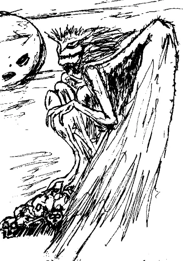

# Статблоки и навыки персонажей Хранителя

## Мерзкокрылая женщина (стрикс)



```stat
СИЛ 55   ВЫН 35   ТЕЛ 55   ИНТ 60   МОЩ 50   ЛВК 55
СКО 12 (в полёте)   ПЗ 11
БкУ: 0   Уклонение 40%
Броня: нет.

Атаки:
Захват 45%: схватив персонажа, стрикс пьёт его кровь. Каждый раунд —
  1d6 СИЛ; когда СИЛ противника падает до 0, стрикс каждый раунд
  высасывает 1d6 ВЫН. Если ВЫН падает до 0, персонаж игрока погибает.
  Каждое очко СИЛ и ВЫН стрикс может прибавить к своей МОЩ или ПЗ
  (если она уже потеряла часть). Чтобы вырваться из захвата, персонаж
  игрока должен пройти проверку СИЛ.
Терзание 45%, 1d6 + БкУ
Зов 45%, 1d3 Рассудка.

Заклинания: контроль разума, превращение в женщину.
Потеря Рассудка: 1d4/1d10.
```

*Прим. перев.: ПЗ 11 — как в оригинале; по ВЫН 35 и ТЕЛ 55 должно быть 9.*

Эта версия стрикса немного отличается от описанной в книге Invictus. Она может снова принимать облик человека (в данном случае женщины), а в облике чудовища выглядит как женщина, но с совиными чертами — крыльями, когтями и когтистыми лапами. Её тело отчасти покрыто перьями. В облике чудовища она по-прежнему говорит по-человечески. Когда игрок встречает стрикса, она уже в облике чудовища. Она ищет пергамент, чтобы призвать Шантака и стать его супругой.

## Цезон Нераций

```stat
СИЛ 45   ВЫН 55   ТЕЛ 65   ИНТ 60   МОЩ 30   ЛВК 35   НАР 30
ОБР 65   СКО 7   ПЗ 9

Навыки: Ближний бой (драка) 35% / Гражданские дела 40% / Империя 50% /
Внимание 35% / Другие королевства 15% / Оккультизм 50% /
Иностранный язык (древнеегипетский) 15%
```

*Прим. перев.: ПЗ 9 — как в оригинале; по ВЫН 55 и ТЕЛ 65 должно быть 12.*

Важный купец в городе Брундизий, судовладелец-магнат. Интересуется мифами и легендами разных частей света.

## Обычный стражник

```stat
СИЛ 55   ВЫН 65   ТЕЛ 55   ИНТ 40   МОЩ 40   ЛВК 55   НАР 35
ОБР 45   СКО 8   ПЗ 10

Навыки: Ближний бой (драка) 35% / Гладиус (меч) 45% / Щит 35% /
Гражданские дела 25% / Империя 30% / Внимание 45% / Слух 40% /
Скрытность 30% / Запугивание 35%
Броня: 1d2
```

*Прим. перев.: ПЗ 10 — как в оригинале; по ВЫН 65 и ТЕЛ 55 должно быть 12.*

## Громила

```stat
СИЛ 35   ВЫН 45   ТЕЛ 50   ИНТ 40   МОЩ 40   ЛВК 40   НАР 25
ОБР 35   СКО 7   ПЗ 6

Навыки: Ближний бой (драка) 35% / Кинжал 35% / Внимание 35% /
Слух 40% / Скрытность 50% / Запугивание 35%
```

*Прим. перев.: ПЗ 6 — как в оригинале; по ВЫН 45 и ТЕЛ 50 должно быть 9.*

## Маллий Каст (чтец новостей)

```stat
СИЛ 35   ВЫН 40   ТЕЛ 45   ИНТ 50   МОЩ 55   ЛВК 50   НАР 55
ОБР 50   СКО 8   ПЗ 10

Навыки: Ближний бой (драка) 25% / Дальнобойное оружие (праща) 35% /
Ближний бой (меч) 35% / Гражданские дела 10% / Империя 20% /
Внимание 45% / Слух 45% / Скрытность 40% / Убеждение 35% /
Красноречие 35% / Оккультизм 25% / Статус 15% / Проницательность 20%
Броня: нет.
```

*Прим. перев.: ПЗ 10 — как в оригинале; по ВЫН 40 и ТЕЛ 45 должно быть 8.*

Близкий друг сыщика. Они выросли вместе, а порой и работали вместе. Любит хорошее вино и красивых людей. Всегда в поисках новостей, которые можно разнести.
