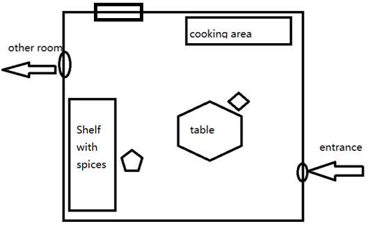
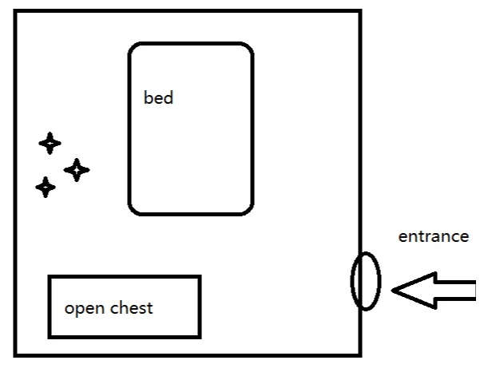

# Раздатки для игрока

## Карта 1

> **Раздатка: карта 1** (дом с совой, общая комната)
>
> - **cooking area** — место для готовки
> - **table** — стол
> - **Shelf with spices** — полка с пряностями
> - **entrance** — вход
> - **other room** — другая комната

## Карта 2

> **Раздатка: карта 2** (дом с совой, спальня)
>
> - **bed** — кровать
> - **open chest** — открытый сундук
> - **entrance** — вход
> - три звёздочки без подписи — орудия пыток (см. с. 10)
