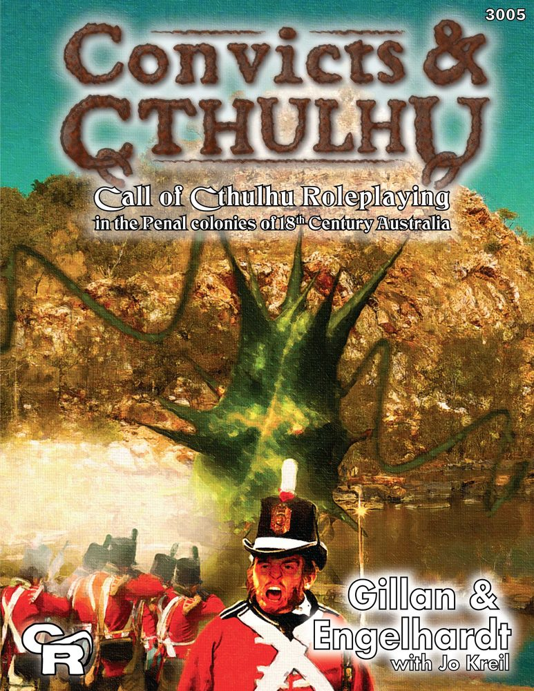

КАТОРЖНИКИ И КТУЛХУ

«Зов Ктулху» в каторжных колониях Австралии XVIII века

Гиллан и Энгельхардт, при участии Джо Крейл

*На обложке — заглавие «Convicts & Cthulhu» и подзаголовок «Call of Cthulhu Roleplaying in the Penal colonies of 18th Century Australia» («Ролевая игра „Зов Ктулху“ в каторжных колониях Австралии XVIII века»); за скалистым берегом реки поднимается огромное зелёное щупальцатое существо, на переднем плане — кричащий офицер в красном мундире и шеренга стреляющих солдат. Внизу — логотип Cthulhu Reborn и имена авторов: Gillan & Engelhardt with Jo Kreil; номер издания — 3005.*
