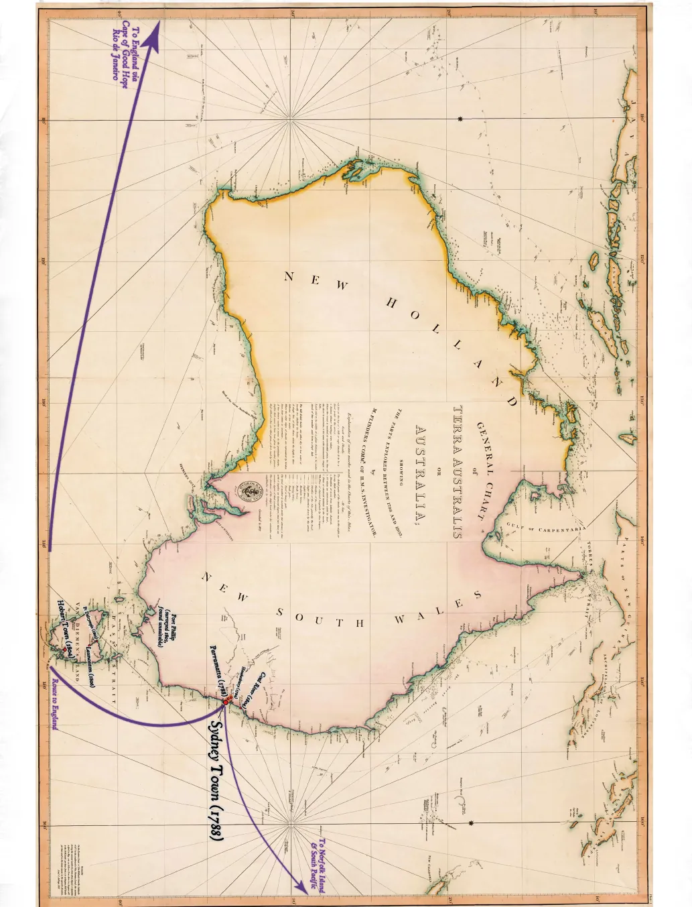

*Карта, показывающая пределы географических знаний о континенте, который называли то Terra Australis, то Новой Голландией, то Австралией. Бо́льшая часть этих сведений получена в исследовательских плаваниях капитана Мэтью Флиндерса из Королевского флота, обогнувшего континент в 1803 году. Показаны и немногочисленные поселения с датами основания.*

*Надписи на карте: «General Chart of Terra Australis or Australia» («Общая карта Terra Australis, или Австралии»); New Holland — Новая Голландия; New South Wales — Новый Южный Уэльс; Sydney Town (1788) — город Сидней (1788); рядом — Парраматта (1788), Хоксбери (1794), Коул-Ривер (1804); Port Phillip — Порт-Филлип (обследован в 1802 году, признан непригодным); на Земле Ван-Димена — Хобарт-Таун (1804), Порт-Далримпл (1804), Лонсестон (1806). Стрелки: «В Англию через мыс Доброй Надежды и Рио-де-Жанейро», «Путь в Англию», «На остров Норфолк и в Южные моря».*
