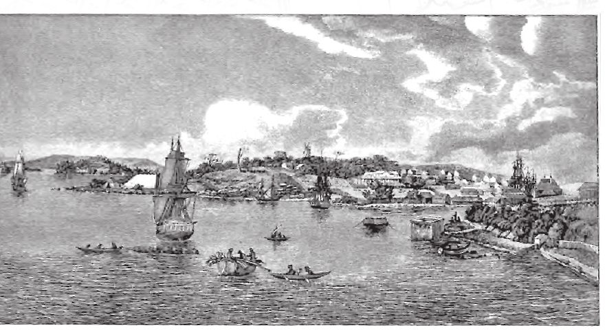

# Часть I. Историческая обстановка

Хотя аборигены живут на континенте, который мы сегодня называем Австралией, более 60 000 лет, европейцы «открыли» его сравнительно поздно для великой эпохи колониальной экспансии. Многие голландские и английские мореплаватели натыкались на его северное и западное побережья в XVII и XVIII веках (нередко случайно), но их рассказы о пустынной и бесплодной земле никого не вдохновили заявить на неё права. Всё изменилось в 1770 году с исследовательским плаванием английского капитана Джеймса Кука на «Индеворе». Куку дали тайное поручение — найти в Тихом океане любые стоящие земли и объявить их владениями короны, пока их не перехватили французы, тогдашние заклятые враги Англии. Открытие пышно-плодородного восточного побережья «Новой Голландии» (так континент называли на ранних картах) стало величайшим успехом экспедиции Кука.

Хотя в Англии весть об открытии Кука приняли с радостью, вскоре разгорелись споры о том, как лучше заселить и использовать новую землю в самом дальнем углу земного шара. Ясно было, что любое притязание на землю в такой дали нужно подкрепить каким-то постоянным поселением (иначе другая колониальная держава непременно её захватит). Но кто захочет жить в таком отрезанном от мира месте? Спор осложнялся острыми общественными бедами, терзавшими тогда Англию, — прежде всего чудовищной перенаселённостью и нищетой Лондона и других промышленных городов. До обретения независимости в 1770-х годах американские колонии были излюбленным местом ссылки британских преступников, наказанных за мелкие преступления. Эта удобная система разгружала переполненные британские тюрьмы и заодно уменьшала население городов. В глазах многих
