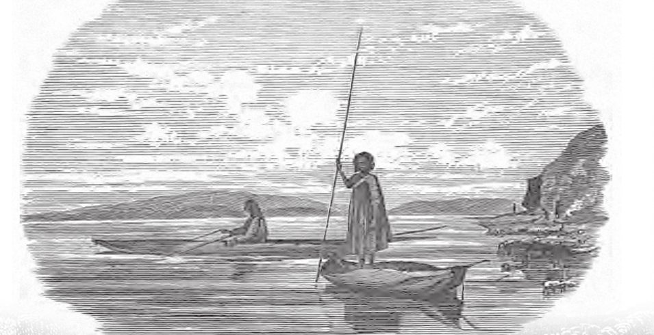

> ### Что колония принесла аборигенам
>
> Несмотря на в целом добрые намерения первых колониальных правительств Нового Южного Уэльса, приход европейцев обернулся бедствием для австралийских аборигенов. До 1788 года в краях, ныне заселённых каторжниками и колонистами, жило многочисленное коренное население, разделённое на 29 кланов. Менее чем за два десятилетия бо́льшая часть этих групп была выкошена. Главный виновник — болезни, прежде всего оспа, завезённая на кораблях из Англии.
>
> Отношения уцелевших аборигенов и европейских поселенцев напряжённые. В большинстве своём аборигены просто хотят, чтобы их оставили в покое и дали жить по обычаям предков, но обстоятельства то и дело делают это невозможным. Немногие из коренных жителей пошли на более решительные шаги, движимые обидой и голодом. Дело доходило до краж, а в нескольких случаях — до открытых нападений на усадьбы. Такие события всякий раз вызывают жестокие ответные вылазки солдат и поселенцев, иные из которых ищут любой повод подстрелить парочку «туземцев». Впрочем, беспорядочные нападения на аборигенов считаются преступлением, и несколько любителей пострелять предстали перед магистратами в Сиднее и были обвинены за такие убийства.

были огромны, этими усилиями руководило колониальное правительство, в целом справедливое (и даже умеренно благожелательное). Жизнь была тяжела, но тьма, таившаяся в сердцах каторжников и столь же порочных тюремщиков, по большей части оставалась погребённой, заглушённой долгими часами изнурительного труда.

Всё изменилось в 1795 году. Из-за внезапной болезни человечному губернатору Артуру Филлипу пришлось спешно вернуться в Англию. Он уехал так поспешно, что Министерство колоний в Британии не успело прислать замену; в качестве временной меры условились, что власть над колонией на время перейдёт к офицеру Корпуса Нового Южного Уэльса Фрэнсису Гроузу. Это единственное решение положило начало долгому сползанию к продажности и жестокости, а в конце концов — к беззаконию.

*Прим. перев.:* год отъезда Филлипа в книге расходится: здесь — 1795, в хронике (с. 10 оригинала) — 1792 (исторически Филлип уехал в декабре 1792 года; Гроуз и Патерсон правили в 1792–1795 годах).

### Ромовая экономика

Безусловно, главные беды военного управления Новым Южным Уэльсом в дни после отъезда Филлипа проистекали из того, что Корпус Нового Южного Уэльса стал торговцем-монополистом — прежде всего в торговле ромом как деньгами. Гроуз был куда менее возвышенным человеком, чем Филлип, и при нём установился порядок, позволявший платить каторжникам за труд пайками рома, — так ром стал в колонии равноценен звонкой монете. Отчасти этот порядок ввели, чтобы облегчить острую нехватку

