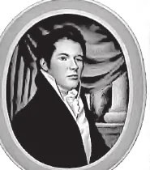

перебили в стычке, которую прозвали «битвой при Винегар-Хилле».

Одно в историях этого периода наверняка сыграет важную роль — жидкая валюта, ром. В сценариях этого времени пути сыщиков могут пересечься с Джоном Макартуром — может быть, как с богатым покровителем, а может быть, как с коварным заклятым врагом. Краткую биографию Макартура см. во врезке рядом.

> ### Джон Макартур
>
> **«Хитрость, коварство, наглость и пара глаз василиска»**
>
> 
>
> Джон Макартур — сын мелкого английского торговца — вступил в Корпус Нового Южного Уэльса в 22 года. В Сидней он прибыл в 1790 году. Обаятельный и напористый человек, он воспользовался междуцарствием, когда колонией правил офицер Корпуса Фрэнсис Гроуз, и сказочно разбогател. В чём-то Макартур был провидцем: он стоял у истоков шерстяного промысла Нового Южного Уэльса, который на протяжении всего XIX века был одной из опор колонии. Но был он и вспыльчивым, непримиримым человеком, не терпевшим никаких помех своим барышам. В 1801 году губернатор Кинг отправил Макартура в Англию под военный суд за дуэль с его командиром. Досталось обеим сторонам, и в конце концов обвинения сняли. Макартур вернулся в колонию и в 1804 году вышел в отставку, чтобы целиком посвятить себя торговле и скотоводству.

### Жизнь при Блае

Правление губернатора Уильяма Блая длилось всего около 17 месяцев (он высадился в Сиднее в августе 1806 года и был насильственно смещён 26 января 1808 года), но это плодородный и богатый событиями период, которым может воспользоваться Хранитель. Напор, с которым Блай наседает на богатых торговцев и офицеров Корпуса Нового Южного Уэльса, вкупе с его колючим и отталкивающим нравом порождает резко расколотое общество. Каждый либо сторонник губернатора, либо сторонник богатой верхушки, и обе стороны настороженно следят друг за другом. Повсюду подрывные заговоры и тайные встречи в задних комнатах — как во Франции накануне Революции. Никто не знает наверняка, куда идут события: воздух наэлектризован, все чувствуют, что рано или поздно что-то должно лопнуть.

В историях о правлении Блая могут звучать темы уловок и обмана: вещи (или люди) не обязательно таковы, какими кажутся. Мотивы персонажей всегда могут быть затуманены — то обманом, то собственной корыстью. Высшие военные и правительственные чины по большей части либо подкуплены богатством и влиянием Корпуса Нового Южного Уэльса, либо попросту отвращены от губернатора его несносными словесными выходками. Ещё одна сторона, которая может сыграть роль в историях, — неуживчивость армии и флота: с самого основания колонии правящая верхушка (губернатор и часть судей) — флотские назначенцы, а всю «чёрную работу» делают армейские. Предсказуемо, это ещё один источник раздоров.

В расследованиях этого периода могут быть прямые встречи с язвительным губернатором Блаем (хотя сыщикам, которых вызовут к нему на разнос, можно только посочувствовать).

Во врезке рядом — краткая биография этого человека и несколько советов о том, как его изображать.

### Время военного правления

Месяцы после Ромового бунта и до прибытия Лаклана Маккуори дают своеобразный, полубеззаконный фон, на котором может получиться интересная и колоритная история. Как и при всяком мятеже, положение человека в обществе под властью военных зависит от того, какую сторону он поддержал во время восстания (или от того, сумеет ли он убедительно доказать, что поддерживал победителей). Отсюда множество разных ролей для персонажей: одни прежде держали власть, но лишились её, другие внезапно возвысились. Повсюду недоверие и ложь — люди толкаются, чтобы заполнить пустоту власти, оставшуюся после краха установленного порядка.
