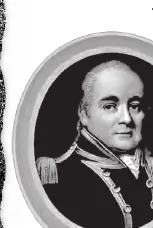

> ### Уильям Блай
>
> **«Тиран, притеснитель, не подобает офицеру»**
>
> 
>
> Уильям Блай родился в 1754 году. До того как стать губернатором Нового Южного Уэльса, он больше всего прославился как капитан корабля Его Величества «Баунти», на котором вспыхнул мятеж — команде опротивело тираническое и подозрительное командование Блая. После мятежа Блая и горстку верных ему людей высадили в маленькую шлюпку, и они совершили исторический переход длиной более 4800 км до Тимора. Флот снял с Блая вину за потерю корабля; к 1806 году у него появились влиятельные покровители в Лондоне, и его избрали преемником губернатора Кинга в Новом Южном Уэльсе. Особое предписание обязывало его пресечь торговлю спиртным в колонии. Блай славился бешеным нравом, вспыльчивостью, энциклопедическим знанием брани и нежеланием менять свои приказы. О нём говорили, что у него «злосчастный дар порождать бунты». В колонии его прозвали «Ублюдок с „Баунти“».

<!-- -->

> ### Как играть Блая
>
> Изображать такую выдающуюся историческую фигуру, как печально знаменитый капитан Блай, — задача, способная смутить Хранителя. Несколько подробностей, которые помогут в игре:
>
> - Блай говорит с выговором Западной Англии. Это тот самый выговор, который прославил — и опошлил — Роберт Ньютон в роли Долговязого Джона Сильвера. Несравненный Энтони Хопкинс говорит с ним в роли Блая в фильме 1984 года «Баунти».
> - Игра Хопкинса хорошо показывает, как Блай мгновенно переходит от рассудительности к крику, особенно если ему кажется, что его не уважают. Не бойтесь так делать.
> - Блай — прямолинейный моряк и плохо переносит заикание, колебания, увёртки и прочие словесные манёвры сыщиков. Это тут же навлечёт его гнев, и выпутаться поможет только сильное **Красноречие**.
> - Не бойтесь, чтобы Блай орал на сыщиков и сыпал проклятиями. Известно, что он тряс кулаком перед лицом тех, кто его разозлил. Если брань вас не смущает, не скупитесь на неё — Блай никогда не скупился.

Хранителю для общего ориентира — все эти обстоятельства возможны:

- **Те, кто деятельно поддерживал Блая до мятежа.** Как правило, такие персонажи окажутся под замком. Мятежная власть состряпает против них какое-нибудь обвинение и либо запрёт их в Доме правительства или в собственных домах, если они влиятельны, либо посадит в тюрьму на неопределённый срок, если нет, либо, если они уже каторжники, отправит в Коул-Ривер.
- **Те, кто до мятежа в целом склонялся к политике Блая.** Мятежники выслеживают в колонии сторонников Блая и требуют подписать петицию с осуждением бывшего губернатора. Если человек подписал, о прежних пристрастиях по большей части забудут; если отказался — он может оказаться на пути за решётку вместе со сторонниками Блая.
- **Те, кто в целом поддерживал мятеж, но не участвовал в его подготовке.** Новый военный режим примет таких людей с распростёртыми объятиями, а любые «досадные» поступки, которые они могли совершить в смуте мятежа, тихо замнут.
- **Те, кто участвовал в подготовке мятежа.** Как правило, такие персонажи — новая верхушка, награждённая землёй и тёплым казённым местом, где почти ничего не надо делать.

Стоит заметить, что, пока держится военное правление, эти перевороты судьбы кажутся вечными. На деле для большинства людей это не так. Все эти положения (кроме земельных наделов, которые могут и остаться) будут пересмотрены, когда прибудет Лаклан Маккуори, и почти без исключений отменены. Запертых врагов мятежников освободят, а их союзников на тёплых местах уволят и вернут их землю короне.
