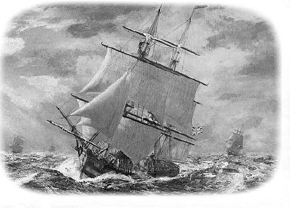

Истории времён военного правления, скорее всего, будут приправлены неопределённостью и непривычностью нового общественного устройства. Каторжники по-прежнему на самом дне, но положение всех остальных перетряхнуто — порой самым неожиданным образом. Как всегда, есть победители и проигравшие, ловкачи и неудачники.

## Главные поселения

Хотя колонию заселили десяток с лишним лет назад, Новый Южный Уэльс всё ещё довольно скромен — и по застройке, и по числу обжитых мест.

Город Сидней — главное поселение колонии; другие поселения основаны в Парраматте к западу от Сиднея и на реке Хоксбери к северу. Сидней — это гавань, место пребывания правительства и купеческие склады; Парраматта — по большей части пастбища; богатые почвы долины реки Хоксбери дают урожай.

По мере роста колонии появляется горстка новых поселений. Одно из первых — Коул-Ривер (позже поселение стали называть Ньюкаслом) на побережье к северу от Сиднея: рыболовство и уголь, который добывают каторжники.

В разделе «Краткий тур по аду» (начинается на с. 33) есть подробная карта города Сиднея. Там же — путеводители по Сиднею и Парраматте и заметки о жалких условиях жизни в Коул-Ривер.

Хотя Новый Южный Уэльс — безусловно, крупнейшая британская каторжная колония в Австралии той эпохи, она не единственная. Есть и небольшие дочерние поселения на острове Земля Ван-Димена (нынешняя Тасмания) и на острове Норфолк. Краткие сведения о них — в разделе «Дальние края» на с. 54.

## Связь с «цивилизованным миром»

Попросту говоря, хотя разбросанные поселения на Австралийском континенте часто сообщаются друг с другом, связь с Британией крайне медленна и ненадёжна. Корабли между Европой и Новым Южным Уэльсом бывают в пути до восьми месяцев, и только с ними можно отправить новости и личные письма. Даже важнейшие новости обходят земной шар месяцами (например, о Ромовом бунте, случившемся в январе 1808 года, в Англии узнали лишь в сентябре того же года). Бывает и так, что корабли тонут — и все письма и посылки на борту идут на дно морское.

До 1809 года между колониями и Англией нет никакой устроенной почтовой службы. Можно было лично договориться с капитаном заходящего корабля и заплатить ему, чтобы он отвёз письмо или посылку в следующем рейсе. Прибыв в нужный порт, капитан отдавал почту тому, кто к нему подойдёт и назовётся получателем. Ясно, что выдать себя за другого при таком порядке было нетрудно. Чтобы обойти эту беду, в 1809 году ввели более упорядоченную казённую систему, которая заодно установила единую плату за письма и посылки. За шиллинг житель Нового Южного Уэльса мог отправить письмо в Англию (письма солдат стоили куда дешевле — всего пенни). Посылка до 9 кг стоила 2 шиллинга 6 пенсов, тяжелее — 5 шиллингов. Когда письмо или посылка приходили по назначению, их клали на казённый склад, а о прибытии сообщали в газете (в «Сидней газетт» — о почте, пришедшей в колонию). Чтобы получить отправление, нужно было обратиться к почтмейстеру и удостоверить перед ним свою личность. В Сиднее обязанности почтмейстера поначалу исполнял мистер Айзек Николс, помощник флотского офицера колонии. Николс вёл почтовые дела у себя дома.

