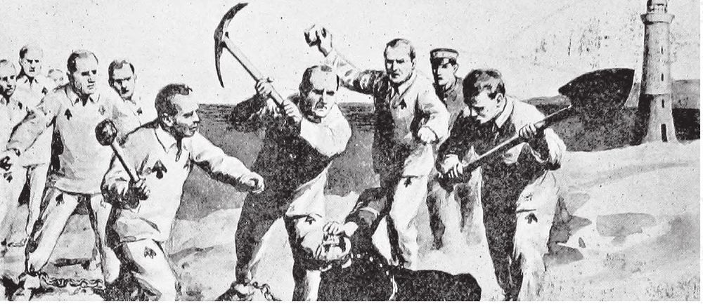

# Часть II. Расследования в колонии

## Создание сыщиков

Сыщики в «Каторжниках и Ктулху» происходят из одной из трёх групп:

- **Коренные австралийцы:** пытаются выжить, пока белокожие чужаки не решат покинуть их земли;
- **Каторжники:** приговорены к ссылке на другой конец света;
- **Свободные поселенцы, охрана и правительственные чиновники:** оказались здесь по своей воле — может быть, в поисках лучшей жизни, может быть, спасаясь от худшей в Англии.

У каждой из этих групп своя общественная иерархия и свои профессии (а также свои шаблоны персонажей, см. с. 21).

## Сыщики-аборигены

Жизнь коренных народов освоенных мест колонии Новый Южный Уэльс изменилась полностью. Это эора с побережья, особенно группы кадигал и вангал в городской местности. Одних оттеснили на окраины, например на реку Хоксбери; другие стали городскими — остались в окрестностях Сиднея и по мере сил продолжают жить рыбной ловлей и охотой. Многие погибли от эпидемии оспы 1791 года и других европейских
