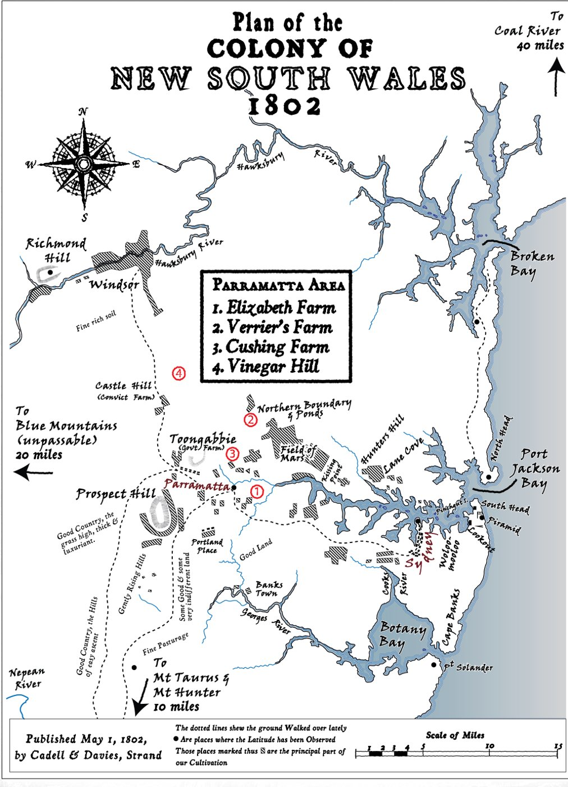

## Карта Нового Южного Уэльса

*Надписи на карте: «Plan of the Colony of New South Wales, 1802» — «План колонии Новый Южный Уэльс, 1802 год».*

**Окрестности Парраматты:**

1. Элизабет-Фарм
2. Ферма Верье
3. Ферма Кушингов
4. Винегар-Хилл

**Прочие надписи:** Richmond Hill — Ричмонд-Хилл; Windsor — Виндзор; Hawksbury River — река Хоксбери; Castle Hill (Convict Farm) — Касл-Хилл (каторжная ферма); Toongabbie (Govt Farm) — Тунгабби (казённая ферма); Northern Boundary & Ponds — северная граница и пруды; Prospect Hill — Проспект-Хилл; Parramatta — Парраматта; Field of Mars — Марсово поле; Hunters Hill — Хантерс-Хилл; Lane Cove — Лейн-Ков; Portland Place — Портленд-Плейс; Banks Town — Бэнкс-Таун; Georges River — река Джорджес; Cooks River — Кукс-Ривер; Botany Bay — Ботани-Бей; Cape Banks — Кейп-Бэнкс; Pt Solander — мыс Соландер; Sydney — Сидней; Woolo-mooloo — Вулумулу; South Head — Саут-Хед; Pyramid — Пирамида; North Head — Норт-Хед; Port Jackson Bay — залив Порт-Джексон; Broken Bay — Брокен-Бей; Nepean River — река Непин; Good Country, the grass high, thick & luxuriant — хорошая земля, трава высокая, густая и пышная; Fine rich soil — прекрасная плодородная почва; Gently Rising Hills — пологие холмы; Some Good & some very indifferent land — земля частью хорошая, частью весьма посредственная; Good Land — хорошая земля; Fine Pasturage — прекрасные пастбища; Good Country, the Hills of easy ascent — хорошая земля, холмы с пологим подъёмом.

**Стрелки:** To Coal River 40 miles — к Коул-Ривер, 64 км; To Blue Mountains (unpassable) 20 miles — к Голубым горам (непроходимы), 32 км; To Mt Taurus & Mt Hunter 10 miles — к горам Таурус и Хантер, 16 км.

**Подпись внизу:** «Издано 1 мая 1802 года, Каделл и Дэвис, Стрэнд». Пунктиром показаны места, недавно пройденные пешком; ● — места, где измерялась широта; места, отмеченные так (штриховкой), — главные участки наших возделанных земель. Масштаб — в милях.

*Прим. перев.:* до Коул-Ривер на карте 40 миль (64 км), в тексте (с. 51 оригинала) — около 160 км.
