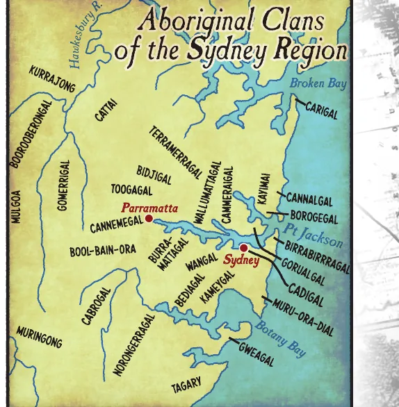

> ### Важность Средств
>
> Когда законных денег не хватает, торгуют чаще всего меною или долговыми расписками (см. с. 27). В такой обстановке **Средства** становятся жизненно важны. Хранитель может просить сыщиков проходить проверку Средств всякий раз, когда идёт обмен, где нужны деньги. Успех означает, что долговую расписку или иное обязательство заплатить приняли. Поэтому у большинства чиновников и военных офицеров в колонии Средства чрезвычайно высоки. Если персонажа перенести в другую обстановку, это значение не сохранится — в таком случае навык делится пополам.
>
> ### Грамотность
>
> Эти правила действуют и для сыщиков, и для персонажей Хранителя. Хранитель решает, умеет ли персонаж читать и писать. Как правило, все офицеры и чиновники грамотны, фермеры и торговцы-эмансиписты полуграмотны, а каторжники неграмотны. Разумеется, бывают исключения.
>
> - **Грамотный:** читает и пишет на родном языке как обычно. Проверка не нужна, если только это не том Мифов или нечто столь же тёмное.
> - **Полуграмотный:** читает и пишет на родном языке как обычно, но всякое чтение требует трудной проверки. Время чтения удваивается.
> - **Неграмотный:** не умеет ни читать, ни писать.
>
> ### Действие опьянения
>
> Пьянство в колонии не редкость. Несколько глотков рома сыщику не помешают, а вот целая бутылка — помешает. Таблица ниже даёт условные ориентиры.
>
> | Выпито | Пример | Действие |
> |---|---|---|
> | Мало | 1–2 стакана | Без помех. |
> | Средне | 3–4 стакана | Проверка ТЕЛ: при провале сложность всех проверок навыков и характеристик повышается на одну ступень на 1d4 часа. |
> | Много | 5–6 стаканов | Проверка ТЕЛ: при провале сложность всех проверок навыков и характеристик повышается на одну ступень на 4 часа. |
> | Чрезмерно | 7+ стаканов | Проверка ТЕЛ: при провале сложность всех проверок навыков и характеристик повышается на одну ступень на 4 часа. Кроме того, все проверки в это время получают один штрафной кубик. |

*Карта «Aboriginal Clans of the Sydney Region» — «Кланы аборигенов в окрестностях Сиднея». Отмечены Парраматта, Сидней, река Хоксбери, Брокен-Бей, Порт-Джексон и Ботани-Бей. Кланы (с севера на юг): курраджонг, буруберонгал, малгоа, каттаи, гомерригал, террамеррагал, биджигал, тугагал, валлуматтагал, каммерайгал, кайимаи, каригал, каннальгал, борогегал, каннемегал, бул-бейн-ора, бурраматтагал, вангал, биррабиррагал, горуальгал, кадигал, бедиагал, кемейгал, муру-ора-диал, каброгал, норонгеррагал, мурингонг, гвеагал, тагари.*

## Шаблоны персонажей

В следующих разделах предложены возможные профессии сыщиков для аборигенов, каторжников и европейцев-некаторжников в колонии.

### Профессии аборигенов

**ОХОТНИК/СОБИРАТЕЛЬ**

Профессиональные навыки: Знание Алчеринги, Искусство/ремесло (любое), Ближний бой или Метание, Слух, Тайные знания (аборигенов), Естествознание, Скрытность, Выживание (буш).

Средства: 0–99 (в общине аборигенов).

Очки профессиональных навыков: ОБР × 2 + ЛВК × 2 или СИЛ × 2.

**ЗНАХАРЬ ИЛИ ЗНАХАРКА**

Профессиональные навыки: Знание Алчеринги, Песнь сновидений, Первая помощь, Тайные знания (аборигенов), Медицина, Естествознание, Оккультизм или Чтение следов или Ближний бой, Выживание (буш).

Средства: 50–99 (в общине аборигенов).

Очки профессиональных навыков: ОБР × 2 + ЛВК × 2 или МОЩ × 2.
