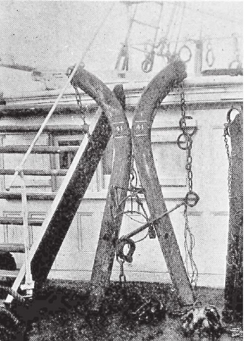

связывают ему руки. Затем его секут плетью с девятью хвостами — «кошкой-девятихвосткой». Наказание обычно исполняет другой каторжник, которого самого могут выпороть, если он будет бить слишком слабо. Нередко друзей заставляют пороть друзей, чтобы разрушить любые узы, которые могут привести к побегам или другим неприятностям.

Число ударов бывает разным, наибольшее — тысяча (поразительно, но некоторые выживали и после этого). Обычно приговаривают в среднем к 20–40 ударам. Двести пятьдесят ударов называли «пробиркой» — уж тут-то проберёт по-настоящему. Если Хранитель затрудняется, пусть бросит d100 и поделит пополам. Если каторжник особенно беспокойный или непокорный, пополам не делите.

Ещё каторжника могут наказать, отправив в команду дробить камни, заставив носить ножные кандалы или сослав в место вторичного наказания вроде острова Норфолк или Коул-Ривер. Высшая мера — смерть через повешение («верёвка, мыло и ситец на одного», как говорят каторжники).

**Заметка для Хранителя.** Если сыщиков-каторжников порют, им нужно пройти **трудную проверку ТЕЛ**. Урон от порки зависит от уровня успеха или провала этой проверки:

- **Чрезвычайный успех:** 1d10 урона за всю порку, как бы жестока она ни была.
- **Трудный успех:** 1d3 урона за каждые 50 ударов.
- **Обычный успех:** 1d6 урона за каждые 50 ударов.
- **Провал:** 1d4 урона за каждые 20 ударов — при суровом приговоре сыщика могут засечь до смерти.
- **Крах:** 1d20+5 урона за порку, а приговор свыше 50 ударов убивает автоматически.

Эту проверку можно повторить, но провал повторной проверки, скорее всего, означает, что персонаж-каторжник буквально истечёт кровью.

## Снаряжение и имущество

Хранителю стоит всячески подчёркивать первобытность жизни в колонии Новый Южный Уэльс. Даже по меркам конца XVIII — начала XIX века существование в этом далёком, отрезанном от мира уголке земли настолько скудно, насколько можно вообразить. Тому есть четыре главные причины:

- **Неумение использовать местные богатства.** Кроме рубки деревьев на лес и ручной добычи камня для построек и угля на топливо, колония Новый Южный Уэльс в это время никак не может воспользоваться (по иронии судьбы, обильными) природными богатствами вокруг. Хотя за этот период удаётся заметно продвинуться к самообеспечению продовольствием (в основном овощами и мясом привезённых коров и овец), даже в таких простейших вещах выживание поселенцев висит на волоске: если не уродится урожай или запоздает корабль снабжения из Англии, людям приходится буквально затягивать пояса, боясь повального голода. Бо́льшая часть снаряжения для колонии должна прийти на корабле из Англии. Поэтому любая вещь — ограниченный и дорогой ресурс: например, хотя есть умения и инструменты, чтобы кузнец «перековал» железные вещи в другие орудия, выплавить новое железо невозможно. Это ограничение сильно сказывается на том, какие вещи
