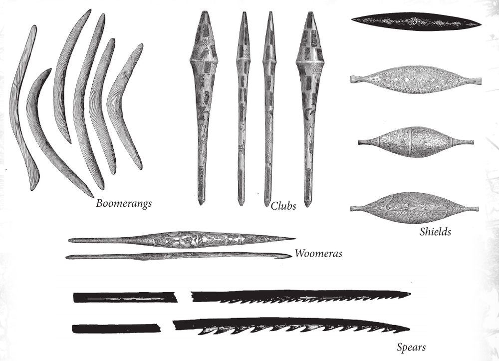

*Подписи на рисунке: Boomerangs — бумеранги; Clubs — дубины; Shields — щиты; Woomeras — вумеры (копьеметалки); Spears — копья.*

### Оружие аборигенов

| Оружие ближнего боя | Урон | Базовый шанс |
|---|---|---|
| Каменный топор | 1d6+1+БкУ | 20% |
| Дубина | 1d8+БкУ | 25% |
| Тяжёлое копьё (двуручное)* | 1d8+1+БкУ | 10% |
| Лёгкое копьё (одноручное)* | 1d6+1+БкУ | 10% |

| Метательное оружие | Урон | Темп | Базовый шанс | Дальность (м) |
|---|---|---|---|---|
| Боевой бумеранг | 1d8 + ½ БкУ | ½ | Метание% | СИЛ × 3/5 |
| Лёгкий бумеранг** | 1d3 + ½ БкУ | ½ | Метание% | СИЛ × 4/5 |
| Метательное тяжёлое копьё | 1d8+1 + ½ БкУ | ½ | Метание% | СИЛ × 1/5 |
| Метательное лёгкое копьё | 1d6+1 + ½ БкУ | ½ | Метание% | СИЛ × 2/5 |

\* Пронзающее.
\*\* Этот бумеранг возвращается к бросившему, если промахнулся; остальные — нет.

Воин-абориген, искусный в обращении с копьём, может воспользоваться вумерой — деревянным приспособлением, которое применяют вместе с копьём: оно придаёт брошенному копью скорость и тем увеличивает его дальность и убойность. С вумерой темп метания копья уменьшается вдвое, но дальность удваивается и к урону прибавляется +1d6. Нужен успех проверки навыка **Ближний бой (вумера)** бросающего; при провале никаких преимуществ нет.
