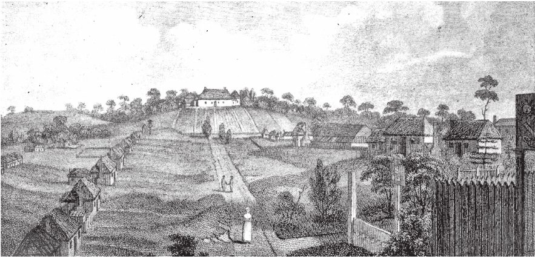

# Часть III. Отчаявшиеся люди, гиблые места

## Краткий тур по аду

В следующих разделах описана историческая обстановка каторжной колонии Новый Южный Уэльс. В этих описаниях нет никаких подробностей о Мифах (так что не ищите здесь, кто прислуживает ми-го или служит Хастуру). Считайте их чистым холстом, на котором вы напишете свой шедевр Мифов: в вашей версии колонии, быть может, эксцентричный француз в Касл-Хилле — агент Братьев кожи, а в жутковатых водах реки Хоксбери обитает ллойгор. В последующих разделах книги есть идеи и советы о том, как с толком использовать тёмные стороны сеттинга в истории ужаса. Там же — подробные наброски сценариев (начинаются на с. 76), а Хранители, ищущие вдохновения о том, как использовать культы и богов Мифов в каторжном поселении, могут взять за образец вводный сценарий «Неласковый приём» (с. 63).

Карта на с. 17 показывает бо́льшую часть колонии Новый Южный Уэльс. На ней нет мест вторичного наказания — острова Норфолк (в Тихом океане, примерно в 1600 км к востоку-северо-востоку от Сиднея) и, с 1804 года, Коул-Ривер (нынешний Ньюкасл). Оба этих небольших поселения были дочерними при главной колонии Новый Южный Уэльс, и каждое отвечало за добычу особого природного сырья (лён на острове Норфолк, уголь в Коул-Ривер) тяжёлым трудом каторжников. Условия в обоих были нарочно суровыми, так что угроза отправки туда была важным способом держать основную массу каторжников в узде.
