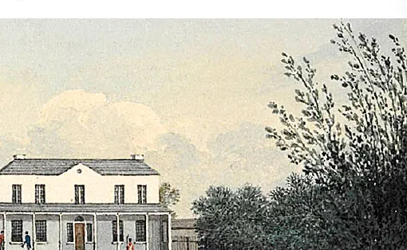

Единственные сколько-нибудь крупные поселения в материковой колонии — городки Сидней и Парраматта. Путеводители по обоим приведены ниже. На с. 51 есть ещё описание главных мест поселения Коул-Ривер. Краткое описание некоторых более отдалённых фермерских округов колонии начинается на с. 53.

> ### Сколько людей в колонии?
>
> Точная численность населения колонии растёт за время, которое охватывает сеттинг, — в основном потому, что из Англии всё прибывают новые каторжники (а вернуться разрешают немногим). В целом в Новом Южном Уэльсе в это время живёт около 6000–7000 европейцев, из которых, возможно, лишь четверть — каторжники, отбывающие срок. Остальные — солдаты, чиновники, свободные поселенцы (те, кто сам решил приехать в колонию, чтобы начать новую жизнь) и каторжники, которые либо отбыли срок, либо были помилованы.
>
> Примечательная черта населения — резкий перекос между мужчинами и женщинами: женщин среди жителей колонии лишь около 18%. Это порождает очевидные общественные беды и напряжение. Ко времени сеттинга в колонии живёт изрядное число детей — одни родились здесь, другие — малолетние каторжники, сосланные обычно за мелкую кражу. В Новом Южном Уэльсе около 800 законнорождённых детей и около 1000 незаконнорождённых.
>
> Сколько аборигенов живёт в колонии и вокруг неё, толком не знает никто — в переписи их не включают. Впрочем, по рассказам, их число, похоже, убывает — из-за болезней, завезённых европейцами, и редких попыток белых стрелять в аборигенов в наказание за мнимые преступления.

## Места Сиднея

Сидней — место первого поселения; он по-прежнему крупнейший каторжный городок и главный порт колонии.

Карта рядом показывает некоторые ключевые места городка Сидней. На следующих страницах описаны здания и люди, которых сыщики, скорее всего, встретят, исследуя это дикое место. В любом отдельном сценарии важна будет лишь малая часть этих людей и мест; Хранителю стоит выбрать те стороны сеттинга, которые лучше всего служат текущей истории, а всё прочее упомянуть мимоходом (чтобы сыщики не заблудились в мелочах).

### 1. Дом правительства

**Где это:** Бридж-стрит, 41.

**Что это:** Дом правительства — первое здание, возведённое в колонии; это двухэтажный дом, задней стороной обращённый к гавани. В рассказах той эпохи Дом правительства описывают как требующий ремонта; и в самом деле, к 1817 году его полностью перестроят.

