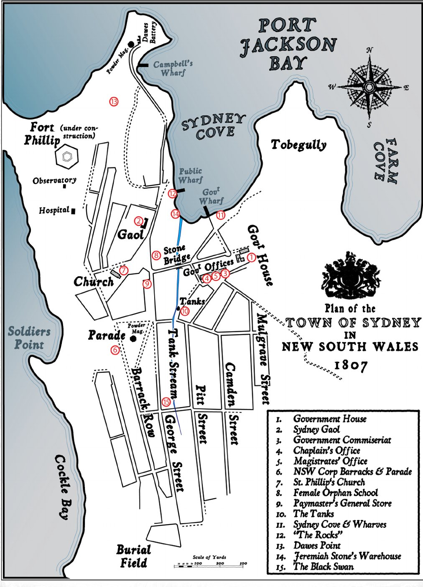

## Карта городка Сидней

*Надпись на карте: «Plan of the Town of Sydney in New South Wales, 1807» — «План города Сиднея в Новом Южном Уэльсе, 1807 год».*

1. Дом правительства
2. Сиднейская тюрьма
3. Казённое интендантство
4. Контора капелланов
5. Контора магистратов
6. Казармы и плац Корпуса Нового Южного Уэльса
7. Церковь Святого Филиппа
8. Школа для девочек-сирот
9. Лавка казначея
10. Танки
11. Сиднейская бухта и пристани
12. Рокс
13. Мыс Доуз
14. Склад Иеремии Стоуна
15. «Чёрный лебедь»

**Прочие надписи:** Port Jackson Bay — залив Порт-Джексон; Sydney Cove — Сиднейская бухта; Farm Cove — Фарм-Ков; Tobegully — Тобегалли; Fort Phillip (under construction) — форт Филлип (строится); Observatory — обсерватория; Hospital — больница; Powder Mag. — пороховой погреб; Dawes Battery — батарея Доуза; Campbell’s Wharf — пристань Кэмпбелла; Public Wharf — Публичная пристань; Gov’t Wharf — Казённая пристань; Gaol — тюрьма; Church — церковь; Stone Bridge — Каменный мост; Gov’t Offices — правительственные конторы; Gov’t House — Дом правительства; Tanks — Танки; Tank Stream — ручей Танк-Стрим; Parade — плац; Barrack Row — Баррак-Роу; George Street — Джордж-стрит; Pitt Street — Питт-стрит; Camden Street — Камден-стрит; Mulgrave Street — Малгрейв-стрит; Soldiers Point — Солджерс-Пойнт; Cockle Bay — Кокл-Бей; Burial Field — кладбище. Масштаб — в ярдах (1 ярд ≈ 1 м).
