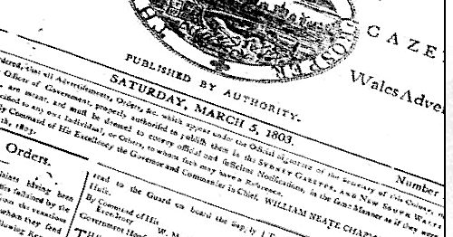

- *Другие констебли и палач колонии.* У главного констебля есть подчинённые — по сути надсмотрщики с обязанностью расследовать и правом арестовывать. Есть и палач, который живёт здесь же.

### 3. Казённое интендантство

**Где это:** Филлип-стрит, Сидней.

**Что это:** деревянный склад с пристроенной конторой, оба знавали лучшие дни. Это временное помещение. Настоящее здание построят лишь в 1809 году, а в 1812 году Маккуори снесёт его и заменит новым.

**Что там происходит:** склад, где хранится бо́льшая часть казённых припасов; он же служит амбаром и местом хранения конфискованных товаров. Здесь же контора комиссара снабжения — ключевой должности в колонии, где столь многое зависит от раздачи казённых припасов; он одновременно казённый счетовод и поставщик товаров.

Персонажи, которые могут быть связаны с этим местом:

> **Комиссар снабжения Джон Палмер.** Всё время, которое охватывает сеттинг, комиссаром снабжения колонии (распорядителем казённых товаров) остаётся Джон Палмер по прозвищу «Малыш Джек». Палмер очень обаятелен, в колонии его любят. У него поместье в 40 гектаров у бухты Гарден-Айленд, где он любит устраивать пышные приёмы. Есть у него и другая ферма, Джордж-Фарм, в Сарри-Хиллс, на 28 гектарах. При первом губернаторе Артуре Филлипе Палмер был казначеем на корабле Его Величества «Сириус» в Первом флоте.

### 4. Контора капелланов

**Где это:** Филлип-стрит, Сидней.

**Что это:** деревянная контора, знававшая лучшие дни, вплотную к интендантству.

**Что там происходит:** эта маленькая контора отведена капелланам колонии — церковным чиновникам, которые служат в церквях Сиднея и Парраматты, а ещё пытаются обратить аборигенов в христианство. Номинально ею ведает Сэмюэл Марсден, хотя его часто не бывает в Сиднее.

Персонажи, связанные с этим местом:

> **Сэмюэл Марсден.** Марсден родился в 1765 году и служит штатным капелланом в колониях с самого прибытия в 1794 году. Он набожен, но долгие годы проповеди каторжникам, равнодушным к спасению души, и солдатам Корпуса Нового Южного Уэльса, развращённым пороком, сделали его циничным и жёстким. Он не только ведает богослужениями колонии (и в Сиднее, и в Парраматте), но и служит судьёй-священником — магистратом, ведущим судебные дознания и процессы. Именно на этом поприще Марсден снискал дурную славу — прежде всего чрезвычайной суровостью наказаний и методов дознания, которые он одобрял. Самый известный случай — в 1800 году, во время дознания об ирландских планах мятежа, Марсден приказал беспощадно выпороть подозреваемого в надежде, что тот выдаст, где спрятано оружие. Отношения Марсдена с губернатором колонии натянуты, не дружит он и с Джоном Макартуром.

### 5. Контора магистратов

**Где это:** Филлип-стрит, Сидней.

**Что это:** большая деревянная контора, знававшая лучшие дни, вплотную к интендантству.

**Что там происходит:** это большое и людное помещение отдано магистратам колонии — тем, кто сообща ведает судебной системой. В колонии нет парламента, о котором стоило бы говорить, поэтому разрешить споры и тяжбы можно только в суде. Из-за этого Новый Южный Уэльс стал крайне сутяжническим обществом, что, в свою очередь, даёт работу многочисленным магистратам — большинство из них почти не знают права, а должность получили благодаря крупным земельным владениям или влиянию.

