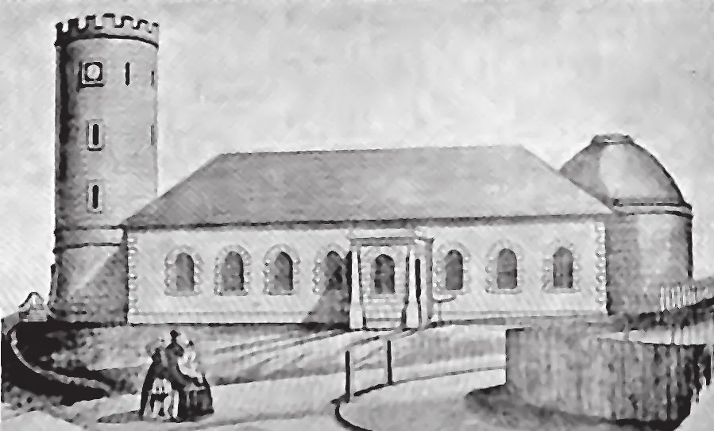

Персонажи, которые могут быть связаны с этим местом:

- *Командир Корпуса Нового Южного Уэльса:* бо́льшую часть времени, которое охватывает сеттинг, эту должность занимал майор Джордж Джонстон, чья судьба тесно связана с Ромовым бунтом (после которого его посадят марионеточным правителем незаконного военного правительства).

> **Джордж Джонстон.** Джонстон родился в 1764 году, был офицером морской пехоты и воевал с американцами в 1777–1778 годах и с французами в 1781 году. В Новый Южный Уэльс он приплыл морским пехотинцем с Первым флотом, а когда морскую пехоту распустили, губернатор Артур Филлип выбрал его, чтобы набрать новую часть — Корпус Нового Южного Уэльса. В 1804 году он руководил действиями против мятежных ирландских каторжников и подавил мятеж, прежде чем дело приняло дурной оборот. Джонстон — красивый и популярный офицер, очень заботящийся о репутации Корпуса Нового Южного Уэльса. Его невенчанная жена Эстер Джулиан приплыла каторжницей с Первым флотом; у них 3 сына и 4 дочери. Джонстон — твёрдый сторонник Макартура и негодует, что флотские офицеры на губернаторском посту (особенно Блай) оскорбляли Корпус и вмешивались в военные дела.

- Любых других офицеров Корпуса Нового Южного Уэльса, стоящих в Сиднее, хотя бы иногда можно застать здесь.

### 7. Церковь Святого Филиппа (и временная замена)

**Где это:** на Черч-стрит, на полпути между солдатским плацем и тюрьмой.

**Что это:** с 1793 по 1798 год здесь стояло деревянное здание с соломенной крышей и земляным полом; потом его сожгли (как говорят, недовольные каторжники). Богослужения перенесли в соседний казённый таможенный склад, наспех переоборудованный. Постройку постоянной замены — церкви Святого Филиппа — начали в 1800 году, но двери она открыла лишь в 1809 году.

**Что там происходит:** богослужения каждое воскресенье; номинально они обязательны для всех солдат и каторжников (за непосещение могут урезать паёк), но этот губернаторский приказ почти никогда не исполняется.

### 8. Школа для девочек-сирот

**Где это:** на углу Джордж-стрит и Бридж-стрит.

**Что это:** школа, основанная в 1801 году, чтобы опекать нуждающихся девочек от 7 до 14 лет (одни сироты, другие брошены). Одновременно здесь живут около 30–40 девочек; за их повседневной жизнью и обучением следит живущая при школе надзирательница (и её муж, смотритель). Учат в основном шить или прясть, а некоторых — читать. Иные цинично говорят, что это немногим больше, чем небольшая швейная фабрика и школа будущей прислуги.

**Что там происходит:** бо́льшую часть времени здание служит для занятий, но порой его используют как удобное место для больших богослужений. Когда в колонии идут крупные судебные процессы, школу обычно временно превращают в фактическое здание суда. Примечательно, что здесь пройдут суд над Джоном Макартуром и «кенгуриные суды», созванные после Ромового бунта.

> **Миссис Элизабет Мор Хьюм.** Дочь священника, Элизабет приехала из Англии с братом в 1795 году — оба намеревались стать свободными поселенцами колонии Новый Южный Уэльс. Вскоре после прибытия она познакомилась с Эндрю Гамильтоном Хьюмом, смотрителем каторжников и фермером, и вышла за него замуж. Ненадолго они переехали в Парраматту, когда Эндрю назначили там казённым кладовщиком, но вскоре назначение отменили, и Эндрю предстал перед судом по обвинению в «служебных нарушениях». Хотя его оправдали, это был лишь первый из нескольких скандалов. Элизабет взялась за должность надзирательницы в новооснованной школе, чтобы поправить дела семьи, но ничего не вышло — напротив, «никчёмный нрав» мужа подорвал веру людей в её способности как старшей наставницы.
