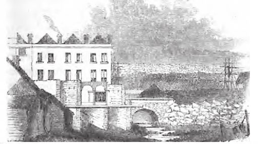

### 9. Лавка казначея

**Где это:** на углу Бридж-стрит и Джордж-стрит.

**Что это:** частная лавка казначея Корпуса Нового Южного Уэльса. Во второй половине эпохи «Каторжников и Ктулху» казначеем был Энтони Фенн Кемп. До него эту должность занимал Джон Макартур (и вёл лавку почти так же, как описано ниже).

**Что там происходит:** Кемп продаёт всевозможные товары, но как казначей ещё и выдаёт жалованье солдатам Корпуса Нового Южного Уэльса. Кемп открыто предпочитает, чтобы солдаты брали жалованье его товаром. Он спрашивает: «Чего желаете? Чаю по 10 шиллингов за фунт?» Если кто-то упорно требует денег, Кемп честит его бунтовщиком и мерзавцем и грозит выпороть за дерзость. Прибыль лавки — около 100%.

> **Капитан Энтони Фенн Кемп**, солдат, магистрат, купец и скотовод. Кемп родился в Олдгейте, в Лондоне. Его жена — Элизабет Райли, у них несколько детей (со временем будет 18). То, как Кемп ради наживы притесняет подчинённых солдат, в Сиднее всем известно. Кемп ненадолго получит назначение на Землю Ван-Димена (Тасманию) и в 1806–1807 годах фактически будет ею управлять. Масон, Кемп с 1802 года состоит в первой ложе Австралии. Он верный сторонник Макартура и сыграет в мятеже одну из главных ролей.

### 10. Танки и ручей Танк-Стрим

**Где это:** ручей течёт с юга на север через центр Сиднея и впадает в Сиднейскую бухту; Танки — на полпути между казармами Корпуса Нового Южного Уэльса и Домом правительства.

**Что это:** Танк-Стрим — естественный пресноводный ручей. Танки — большие водоёмы, вытесанные в камне, где собирается вода из ручья. Через Танк-Стрим перекинут мост — единственный каменный мост в колонии, — который все единодушно считают из рук вон плохо построенным.

**Что там происходит:** люди каждый день приходят к Танкам за пресной водой. Вода важна для городка и для пополнения запасов кораблей в гавани. Качество воды в ручье (а значит, и в Танках) сильно колеблется, потому что некоторые промыслы выше по течению (особенно кожевенные) начали сбрасывать в него отходы.

- **Дом и склад Саймона Лорда.** Саймон Лорд — один из самых преуспевающих купцов-эмансипистов Сиднея. Его трёхэтажный дом со складом стоит у моста через Танк-Стрим. Корабельные офицеры порой останавливаются здесь, когда хотят быть поближе к своему товару.

### 11. Сиднейская бухта: пристани и склады

**Где это:** Сиднейская бухта рядом с Роксом.

**Что это:** множество разных мест: сама гавань и корабли в ней; Казённая пристань; частные склады; верфь; несколько питейных заведений.

**Что там происходит:** гавань — средоточие торговли и сообщения в колонии. Несколько примечательных мест:

- **Верфь Джеймса Андервуда.** Джеймс Андервуд — судостроитель и судовладелец из эмансипистов. Его верфь — крупнейшая в Сиднее. Андервуд в доле с Генри Кейблом, другим купцом-эмансипистом; вместе они владеют шлюпом «Диана».
- **Корабли в гавани.** Обычно здесь в любой момент стоят несколько крупных казённых кораблей, одно-два торговых судна и с дюжину рыбацких лодок. Есть и постоянное паромное сообщение: каждый день между Сиднеем и Парраматтой ходят лодки и баржи — путь занимает около 4 часов. Время от времени корабли уходят и в более далёкие места (в том числе в места вторичного наказания — Коул-Ривер и остров Норфолк, а также в единственное другое поселение в Австралии — каторжную колонию на Земле Ван-Димена, далеко на юге).
