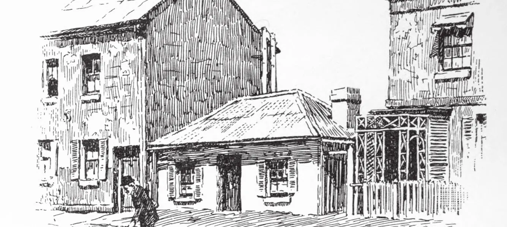

- **Склад и пристань Роберта Кэмпбелла.** У Кэмпбелла есть частная пристань и склад — часть его торгового дела «Кэмпбелл и К°».

Персонажи, которые могут быть связаны с этими местами:

> **Томас Джеймисон**, главный хирург. Немолодой ирландец Томас Джеймисон — главный хирург колонии. При Филлипе он был помощником хирурга на корабле Его Величества «Сириус». Вместе с Джоном Харрисом и Джоном Сэвиджем он провёл в колонии первую успешную прививку детей от оспы и опубликовал первую в колонии медицинскую статью. Он ещё и купец, и союзник Макартура. Вскоре после назначения Блая губернатором Джеймисон крупно ссорится с ним из-за отказа в просьбе вернуться в Англию.
>
> **Джон Харрис**, хирург Корпуса Нового Южного Уэльса. Ирландец Джон Харрис — штатный хирург Корпуса Нового Южного Уэльса. Во времена «ромовой экономики» при губернаторе Кинге он стойкий сторонник правительства. Однако вскоре после прихода к власти Блай снимает его с должностей флотского офицера и магистрата, и Харрис круто переходит на сторону тех, кто призывает к мятежу. Ко времени Ромового бунта дом Джона Харриса в Ультимо — одно из главных мест, где мятежники тайно вынашивают заговор.
>
> **Роберт Кэмпбелл**, флотский офицер. Флотский офицер колонии ведает ввозом и вывозом. До 1807 года эту должность занимал Джон Харрис (см. выше), но Блай назначает вместо него своего человека — Роберта Кэмпбелла. Свободный поселенец, Кэмпбелл приехал в колонию из Шотландии в 1797 году и утвердился как купец, слывущий честным торговцем: щедро даёт в долг и держит низкие цены. Он поддерживает Блая, полагая, что тот старается сделать колонию справедливее и помочь бедным. Ещё он сторонник Лондонского миссионерского общества и через него оплачивает разные благотворительные дела.

### 14. Образец склада: склад Иеремии Стоуна

В расследовании, связанном с товарами или вещами, привезёнными в колонию, вполне могут найтись улики, указывающие на склад у гавани. Склад Иеремии Стоуна приведён здесь как типичный образец такого места. Хранитель может использовать его как есть или подправить описание, чтобы создать сколько угодно похожих мест.

**Где это:** Рокс, у набережной.

**Что это:** двухэтажный деревянный склад с маленькой конторой наверху и узким чердаком.

**Что там происходит:** Иеремия Стоун сдаёт складские помещения другим купцам, которым они нужны. Он не задаёт вопросов, а его цены не так грабительски монопольны, как у многих других местных торговцев, поэтому клиентов у него хватает.

Персонажи, которые могут быть связаны с этим местом:

> **Иеремия Стоун**, беспринципный владелец склада. Стоун — худой, замкнутый человек 41 года с длинными прямыми волосами неестественно серого цвета. Хотя он постоянно ведёт дела с разными тёмными личностями (возможно, на усмотрение Хранителя, и с культистами Мифов), сам он не интересуется ни их делами, ни верованиями — только их деньгами. Он не прочь поучаствовать в тайных разнузданных попойках с ромом, что время от времени устраиваются. Вполне возможно, его удастся уговорить сдать часть склада под такие развратные сборища — если цена будет подходящей.

### 15. Образец питейного заведения: «Чёрный лебедь»

В большинстве сценариев в Сиднее персонажи будут так или иначе заходить в питейное заведение — для примера приведено печально известное заведение Саймона Лорда «Чёрный лебедь».

**Где это:** Джордж-стрит.

**Что это:** «Чёрный лебедь» — первое дело, которое Саймон Лорд завёл после освобождения. Это скромное главное здание с несколькими деревянными пристройками. Оно стоит рядом с лавкой Джона Хафпенни.

**Что там происходит:** выпивка, общение, сплетни. В конце эпохи «Каторжников и Ктулху» оно становится главным местом встреч тех, кто плетёт заговор против губернатора.
