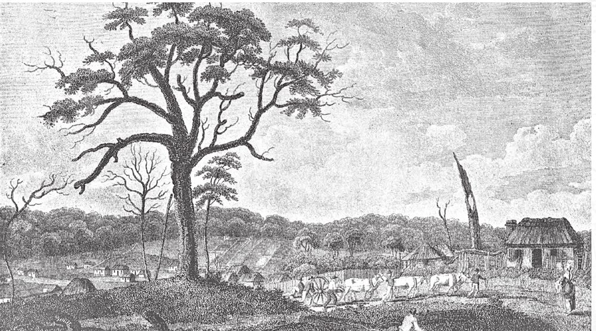

> **Беннелонг** изначально был вождём клана народа вангал на южном берегу реки Парраматты. В 1789 году первый губернатор колонии Новый Южный Уэльс Артур Филлип приказал схватить кого-нибудь из аборигенов и доставить в Сидней, чтобы он служил посредником между коренными жителями и колонистами. Беннелонг был не первым, кого для этого схватили, но первым, кто прожил достаточно долго, чтобы выучить английский и стать полезным губернатору. Хотя его забрали у его народа против воли, Беннелонг подружился с губернатором — видимо, понимая, как важно для его народа иметь какие-то «дипломатические» пути к вождям белого поселения. Когда в 1792 году губернатор Филлип по болезни был вынужден вернуться в Англию, он попросил Беннелонга поехать с ним.
>
> Беннелонг прожил в Англии три года; его водили напоказ к многим видным политикам того времени. Заболев, он вернулся в Австралию в 1795 году на корабле Его Величества «Релайанс» и 7 сентября ступил на родную землю. По возвращении Беннелонг какое-то время был советником нового губернатора (Кинга), но в конце концов предпочёл жить по обычаям своего народа, а не с европейцами. Примерно в 1797 году Беннелонг возвращается в земли вокруг Парраматты и становится вождём другого клана. Он живёт на земле, принадлежащей Джеймсу Скуайру.

### Городок Парраматта

**Где это:** на берегах реки Парраматты, впадающей в самую западную оконечность залива Порт-Джексон (огромного залива, в который входят Сиднейская гавань и множество других бухт).

**Что это:** Парраматта — первое поселение, основанное после Сиднея. Это окружной центр для множества ферм свободных поселенцев, разбросанных по окрестностям, и место стоянки гарнизона солдат Корпуса Нового Южного Уэльса.

**Что там происходит:** городок Парраматта стоит прямо на реке, на широкой равнине, и его пересекает большая главная улица. В нём около 180 строений и 1500 жителей. Почти все — фермеры. Другие постройки:

- Небольшая больница, где живёт мистер Д’Арси Уэнтуорт; он слывёт превосходным врачом.
- Большие армейские казармы (см. с. 47).
- Главная церковь ещё строится.
- Несколько питейных заведений, самое процветающее из которых — «Масонский герб» (см. с. 47).
