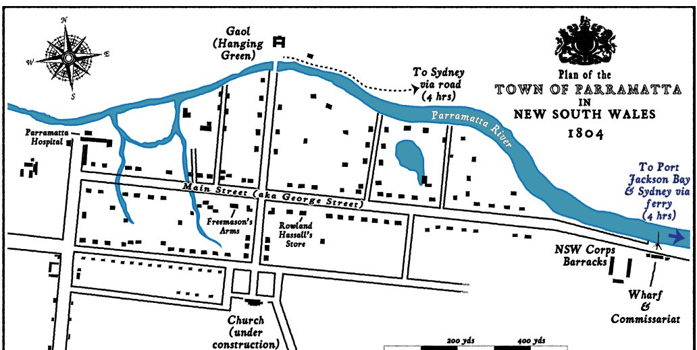

## Карта городка Парраматта

*Надписи на карте: «Plan of the Town of Parramatta in New South Wales, 1804» — «План города Парраматты в Новом Южном Уэльсе, 1804 год»; Gaol (Hanging Green) — тюрьма (Хэнгинг-Грин); Parramatta Hospital — больница Парраматты; Main Street (aka George Street) — Главная улица (она же Джордж-стрит); Freemason’s Arms — «Масонский герб»; Rowland Hassall’s Store — лавка Роуленда Хассалла; Church (under construction) — церковь (строится); NSW Corps Barracks — казармы Корпуса Нового Южного Уэльса; Wharf & Commissariat — пристань и интендантство; Parramatta River — река Парраматта; To Sydney via road (4 hrs) — в Сидней по дороге (4 часа); To Port Jackson Bay & Sydney via ferry (4 hrs) — к заливу Порт-Джексон и в Сидней паромом (4 часа). Масштаб — в ярдах (1 ярд ≈ 1 м).*

- Бывший миссионер Роуленд Хассалл держит здесь лавку, где продаёт, среди прочего, ткани из Южных морей.
- Интендантство Парраматты. Казённый склад, подобный сиднейскому интендантству.
- На другом берегу реки стоит здешняя каторжная тюрьма, которую иногда называют Хэнгинг-Грин — «Висельный луг» (см. ниже).

### 1. Тюрьма на Хэнгинг-Грин

**Где это:** на другом берегу реки Парраматты от основного городка.

**Что это:** здешняя тюрьма для содержания каторжников, и мужчин, и женщин. Каторжниц здесь изрядно. Многие окрестные фермы берут в домашнюю прислугу женщин из числа узниц, и те, что не живут у своих хозяев — свободных поселенцев, живут здесь. В 1804 году смотритель тюрьмы затевает опыт — создать Женскую фабрику: мастерскую на верхнем этаже тюрьмы, где каторжницы работают на ткацких станках. Для этого ставят станки и нанимают мастера-ткача; к несчастью, хотя затея удалась, первую Женскую фабрику Парраматты через несколько лет в конце концов бросают, когда здание тюрьмы сильно обгорает при пожаре, устроенном каторжниками.

**Что там происходит:** здесь спят каторжники, здесь же их порют и (в некоторых случаях) казнит палач. С 1804 до конца 1807 года Женская фабрика выпускает первую в колонии ткань местного производства, часть которой даже вывозят обратно в Англию.

Персонажи, которые могут быть связаны с этим местом:

> **Джордж Милмейкер**, мастер-ткач. Шотландец скромного происхождения, но хорошо обученный работе на ручном ткацком станке — с детства он смотрел, как работает ткацкая мастерская его отца в Данди. У Милмейкера была бунтарская жилка: он входил в общества, созданные, чтобы отстаивать идеалы Французской революции. Эти убеждения и его открытые попытки их печатать навлекли на него гнев британского правительства, и в конце концов его судили за подстрекательство к мятежу и «приведение к незаконной присяге». В 1800 году его сослали в Новый Южный Уэльс, где его ткацкое мастерство привлекло внимание губернатора Кинга, желавшего завести ткацкую мастерскую с каторжным трудом. Так его назначили смотреть за первой Женской фабрикой и он получил условное помилование. К несчастью, прибытие Блая (которого ткацкая мастерская почти не интересовала) и трагическое уничтожение Женской фабрики огнём в 1807 году сломили Милмейкера. Он умрёт в 1808 году в нищете и пьянстве.
