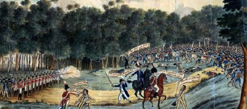

Персонажи, которые могут быть связаны с этим местом:

> **Барон Веринкур де Кламб**, эксцентричный свободный поселенец. Этот мелкий французский дворянин прибыл в колонию Новый Южный Уэльс в 1801 году — а вернее сказать, бежал от смуты, начавшейся после Французской революции. Губернатор Кинг пожаловал ему 80 гектаров, и барон устроил ферму, где пытался выращивать виноград, хлопок и кофе. Его большой дом — «Эрмитаж» — местные насмешливо прозвали «Замком», отсюда и пошло название Касл-Хилл.

### 6. Образец небольшой фермы: ферма Кушингов

Сценарии в Парраматте могут вовлечь сыщиков в расследование дел местных свободных поселенцев — будь те исполнителями ужасов Мифов или их жертвами. Немногие поместья поистине роскошны (как описанная выше Элизабет-Фарм Джона Макартура), большинство скромны. Если Хранителю для игры нужна небольшая ферма свободного поселенца, этот образец — ферма Кушингов — станет подходящим шаблоном, по которому можно скроить свою.

**Где это:** в 1,6 км от центра городка Парраматта.

**Что это:** дом из плетня и обмазки, сарай и возделанные под посевы участки. Днём пасутся коровы и овцы, ночью их загоняют в сарай.

**Что там происходит:** земледелие, домашнее хозяйство, немного огородничества.

Персонажи, которые могут быть связаны с этим местом:

> **Джулиус Кушинг**, фермер. Кушинг — преданный муж, но заботы о ферме в колониальном обществе отнимают у него столько сил, что ни на что другое времени не остаётся. Он член Верноподданной ассоциации Парраматты (местного добровольного ополчения) и не раз присоединялся к отрядам, выслеживавшим шайки грабящих аборигенов.
>
> **Миссис Кэролайн Кушинг**, жена фермера. Миссис Кушинг — привлекательная, хотя и усталая на вид женщина с чёрными волосами, небрежно собранными в узел, и серыми глазами. Она дружелюбна к сыщикам, если только те не явные задиры, и сочувствует каторжникам — особенно тем, у кого, по её мнению, добрая натура.

> **Дженни Милгрим**, служанка-каторжница. В Англии Дженни была проституткой; её осудили за кражу у богатого клиента и приговорили к 14 годам ссылки. Она прибыла недавно, но её взяла под крыло миссис Кушинг, считающая своим христианским долгом помочь заблудшей девушке. Дженни — хорошая работница, но пуглива и очень суеверна. Она боится двух каторжников, Данкла и Смогга, распределённых на ферму работниками. Кушинги разрешают Дженни ночевать на ферме: так ей удобнее служить семье.
>
> **Данкл и Смогг**, распределённые каторжники. Грязные и вонючие, эти двое — распределённые каторжники, присланные на ферму для чёрной работы. Данкл высокий, долговязый и грязный, с жидкими волосами и придурковатой ухмылкой. Смогг низенький, неразговорчивый и грязный, с фальшиво-заискивающей манерой. Оба бывают на ферме только днём — на ночь они обязаны возвращаться в тюрьму Парраматты.

### 7. Образец большой фермы: ферма Верье

Если Хранителю для игры нужна более крупная и зажиточная местная ферма, этот образец — ферма Верье — станет хорошим шаблоном.

**Где это:** за фермой Кушингов, примерно в часе пути от Парраматты.

**Что это:** деревянный дом и две деревянные пристройки. Ферма стоит на 120 гектарах, пожалованных Верье как свободному поселенцу.

**Что там происходит:** земледелие, домашнее хозяйство, немного огородничества. Главный урожай — кукуруза и другие зерновые. В пристройках может размещаться и иной (возможно, незаконный) промысел — например, пивоварня или перегонка спиртного. А может, это просто хранилища для тюков сена. Скота около 100 голов: свиньи, козы, птица и овцы, коров и лошадей меньше.
