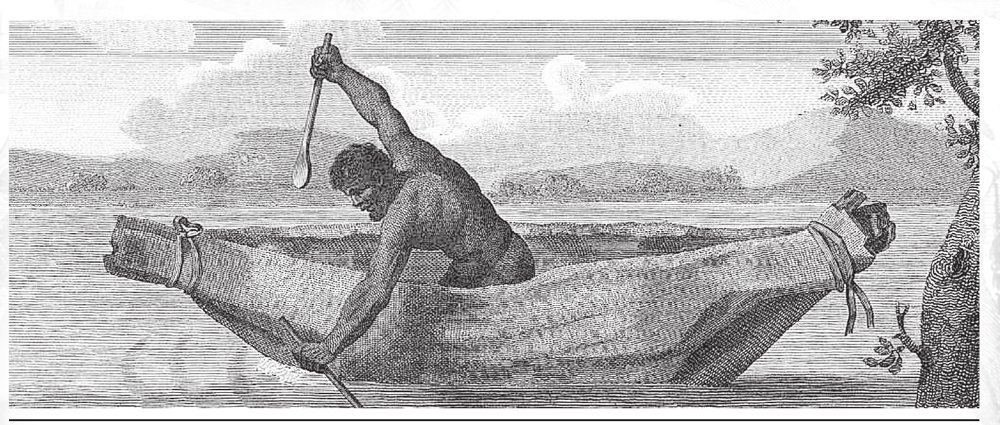

Персонажи, которые могут быть связаны с этим местом:

> **Уильям Верье**, фермер. Сердечный и дружелюбный свободный поселенец Верье пользуется в Парраматте всеобщей симпатией и особенно любим завсегдатаями «Масонского герба», где его можно застать почти каждый вечер. Уроженец Корнуолла, Верье приехал в Новый Южный Уэльс искать своё будущее лет пять назад. Он один из немногих неженатых мужчин в округе — и к тому же владелец немалой фермы, — так что вокруг полно толков о том, что Верье вот-вот возьмёт жену и обзаведётся семьёй. Подходящих невест среди дочерей местных семейств хватает, но Верье, как известно, становится застенчив и немногословен всякий раз, когда об этом заходит речь. Вместо семьи хозяйство ведут распределённые каторжники-работники — по крайней мере пока.

- *Прочие:* Верье живёт один, но обычно на таких фермах живут 2–3 взрослых члена семьи и 3–5 детей. На ферме Верье работают 5 распределённых каторжников — обычная норма, положенная каждому поселенцу.

## Стоянки аборигенов у Парраматты

Бидьигал — из «лесных племён», как называли их первые поселенцы: аборигены, у которых было мало дружеских встреч с белыми. Они живут рыбной ловлей в реке, охотой в буше на местных зверей и сбором местной пищи вроде яиц муравьёв-бульдогов. Их копья зазубрены маленькими острыми камнями. Опоссумы, кенгуру и эму — духи-предки бидьигал. Беспричинный вред им навлечёт скорое возмездие.

> **Пемулвуй** — самый знаменитый из бидьигал. Он прославился как один из немногих вождей аборигенов, которые успешно воевали с европейцами и прожили достаточно долго, чтобы стать для них настоящей занозой. В сценариях, действие которых идёт в начале эпохи «Каторжников и Ктулху», сыщики наверняка услышат испуганный шёпот в Парраматте о дерзких вооружённых набегах Пемулвуя на поселенцев округи. Большинство набегов на самом деле — ради еды: аборигены особенно часто крадут с ферм кукурузу. Некоторые — «расплата» за зверства, которые поселенцы учинили над местными аборигенами (например, похищение их детей).
>
> Свою войну набегов Пемулвуй начал в 1792 году, и, несмотря на немалые усилия колонистов поймать или убить его, вождь будто был заговорён — он ускользал и от солдат, и от поселенцев. Со временем его неуязвимость (по крайней мере в глазах местных аборигенов) приобретает сверхъестественный оттенок. Люди начинают верить, что его попросту невозможно убить. В конце концов это оказывается неправдой: в 1802 году моряк и исследователь Генри Хакинг выслеживает Пемулвуя и застреливает его, чтобы получить назначенную правительством награду за его голову. В назидание тогдашнее правительство приказало отрезать Пемулвую голову и отправить её в Англию заспиртованной.

Позже, в дни накануне Ромового бунта, сын Пемулвуя Тедбери делит время между землями предков и фермой Макартура, выжидая случая пронзить губернатора копьём (см. «Элизабет-Фарм» на с. 48).
