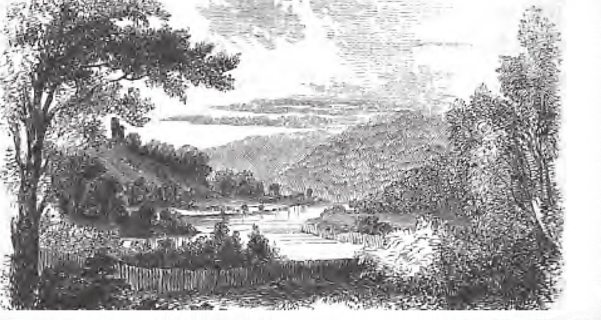

горстки (отчасти из-за так называемой «Чёрной войны», в ходе которой белые колонисты печально прославились истреблением многих групп коренных жителей).

Из Сиднея до Хобарт-Тауна — около 3 недель под парусом. Кроме главного каторжного поселения в Хобарт-Тауне, есть поселение поменьше — Порт-Далримпл на северном берегу Земли Ван-Димена.

## Остров Норфолк

Остров Норфолк — маленький вулканический остров в Тихом океане, примерно в 1600 км к северо-востоку от Сиднея. Как и Землю Ван-Димена, Норфолк колонизировали отчасти для того, чтобы он не достался французам. Остров заселил лейтенант Кинг (впоследствии губернатор Нового Южного Уэльса) вскоре после основания Сиднея. Поселение было основано как место вторичного наказания, куда каторжников могли отправить, чтобы с ними обошлись ещё более жестоко, чем в Сиднее.

Деревья острова Норфолк поначалу должны были дать мачты для кораблей в войне с Наполеоном, но оказались непригодны ни на что, кроме постройки хижин.

В 1806 году население острова Норфолк — всего 694 человека. Из Сиднея до острова Норфолк — около 20 дней под парусом.

### Другие исследованные места

В этот период бо́льшая часть австралийского континента остаётся белым пятном на карте: европейцы нанесли общие очертания берегов, но исследований почти не было. Район Порт-Филлипа (нынешний Мельбурн) ненадолго рассматривали в 1803 году, когда искали места для новых каторжных поселений, но выяснилось, что пресной воды там слишком мало, чтобы стоило селиться. (Вместо этого корабли пошли дальше и заселили Землю Ван-Димена — без горстки каторжников, которые воспользовались случаем, сбежали в буш, и больше о них никто не слышал.)

Немного исследовали и побережье к северу от Сиднея: некоторые суда доходили до залива Моретон (у нынешнего Брисбена). Суда из Нового Южного Уэльса также несколько раз ходили изучать острова Новой Зеландии, где, как известно, живёт коренной народ, совсем не похожий на австралийских аборигенов. Попыток поселиться там пока не было.

Многие исследования колонии заглохли в 1803 году, когда французы неожиданно заточили Мэтью Флиндерса, лучшего морского исследователя колонии, на пути в Англию. Во время стоянки на острове Маврикий в Индийском океане его схватили и задержали как военнопленного (незадолго до того была объявлена война с Наполеоном). Его освободят только в 1810 году.

