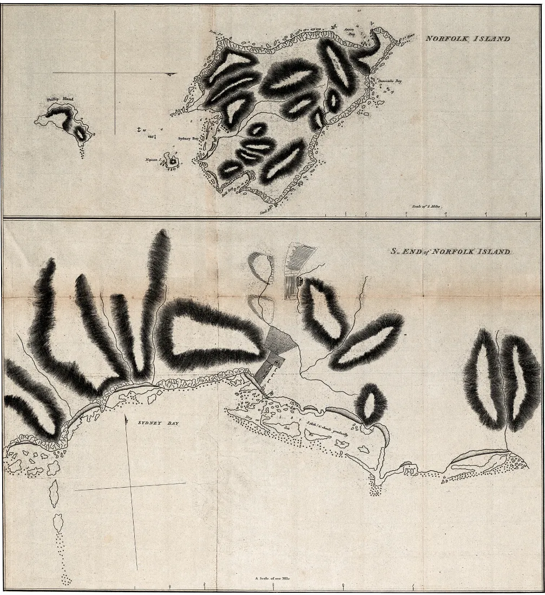

## Карта острова Норфолк, 1788 год

*Надписи на карте:* вверху — «Остров Норфолк» (Norfolk Island), к западу — остров Филлип (Phillip Island) и островок Непин (Nepean), у южного берега — залив Сидней (Sydney Bay), на восточном берегу — заливы Энсон (Anson Bay) и Данкомб (Duncombe Bay); масштаб — 5 миль (8 км). Внизу — «Южная оконечность острова Норфолк» (S. End of Norfolk Island) с заливом Сидней и поселением; масштаб — 1 миля (1,6 км).
