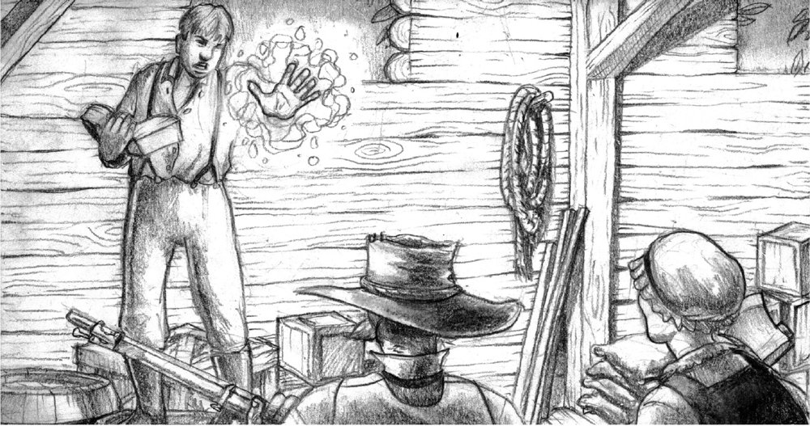

# Часть IV. Тёмная Южная земля

В унылых каторжных поселениях Нового Южного Уэльса немало тьмы — и столь же много жутких тайн, с которыми новоприбывшие европейцы только начинают сталкиваться, расселяясь по этой земле. Ужасы обоих родов могут стать плодотворным источником вдохновения для сценария или кампании «Зова Ктулху» в эпоху «Каторжников и Ктулху». В следующих разделах приведены примеры, но Хранителю советуем и самому приложить творческую фантазию, населяя этот новый мир его собственными, ни на что не похожими ужасами.

## Культы в колонии

Хранитель, которому для сценария «Зова Ктулху» нужны мужчины и женщины с чёрным сердцем в роли противников, найдёт в первых каторжных поселениях Нового Южного Уэльса настоящую сокровищницу. Почти по замыслу большинство населения этого отрезанного от мира места — отбросы Британии и её империи: неудобные члены общества, не вписывающиеся в принятый образец благопристойности. Среди этих вольнодумцев, бунтарей и негодяев хватает приверженцев веры в странных и противоестественных богов. Одни держат свои чёрные обряды при себе, но другие жаждут, чтобы те расползлись как раковая опухоль. Именно эти последние и стоят за несколькими подрывными «культами», которые сейчас процветают в Новом Южном Уэльсе.

В следующих разделах — несколько идей для связанных с Мифами групп каторжников, солдат и других колонистов, которых Хранитель может сделать противниками в сценарии или кампании. Не все они непременно действуют в каждый момент этой эпохи или во всех частях поселения.
