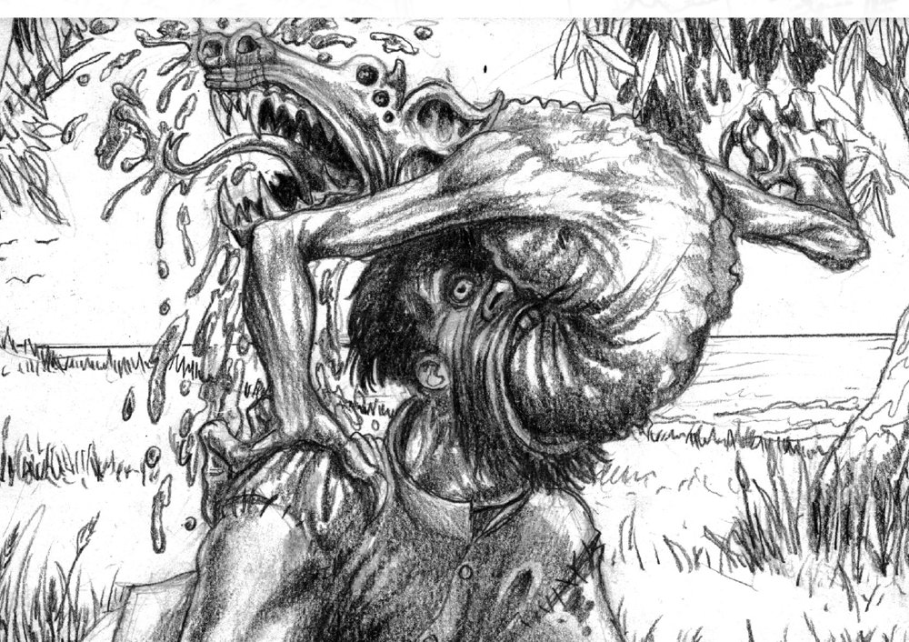

таинственно появляются на Марсовом поле — и нередко просто исчезают через час или через день. Иногда это мерзкие слюнявые твари — звероподобные создания из Тиндала, которые буквально сочатся из углов между ветвями деревьев. А иногда — полуматериальные боевые машины, которыми управляют чуждые разумы йитов, перенёсшиеся сюда со своей родины, отстоящей на полмиллиарда лет в прошлое.

**Алчеринга по нечаянности.** Большинство каторжников и солдат колонии Новый Южный Уэльс довольствуются привычными пороками, привезёнными из Англии, — в основном ромом и табаком, — но кое-где этого добра не хватает. В глухих местах вроде окрестностей Коул-Ривер или верховий Хоксбери поселенцы и каторжники, жаждущие дурмана, выменивают у местных аборигенов листья питури. Поселенцы считают их чем-то вроде туземного жевательного табака, и в малых дозах питури и вправду действует как лёгкий стимулятор (хотя на вкус отвратителен). Чего не знает никто из европейцев, жующих питури, — так это того, что эти листья тысячелетиями служат важным средством связи с духами и сказаниями Алчеринги — Времени сновидений аборигенов. Небольшое количество питури, скорее всего, никого не проймёт настолько, чтобы случилось что-то странное, но среди каторжников уже есть несколько заядлых жевунов, которые начали видеть необычные видения и чувствовать странное влечение войти в древние земли и сказания. Большинство из них слишком сбиты с толку этими ощущениями, чтобы что-то с ними делать, но если кто-нибудь когда-нибудь возьмётся изучить эти странные явления более научно, они могут оказаться загадочной связью со странным и вневременным легендарным краем. Одно несомненно: ни один абориген не станет охотно помогать в таком исследовании. Кто бы из них ни продал питури белым, он уже нарушил табу. Усугублять это прегрешение не захочет никто.

## Новые кошмары

Изобретательный Хранитель легко найдёт способы вплести традиционных богов и чудовищ Мифов Ктулху в мрачный мир колониального Нового Южного Уэльса. Эти ужасы могли прийти вместе с европейскими поселенцами — быть может, как тёмная сторона опасных верований немногих, — а могли появиться в результате странного столкновения древних оккультных сил и новых верований колонистов.

Ниже — несколько конкретных идей; ещё больше предложений — в «Secrets of Australia» от Chaosium, где есть обширный раздел об ужасах Мифов в австралийском сеттинге.
