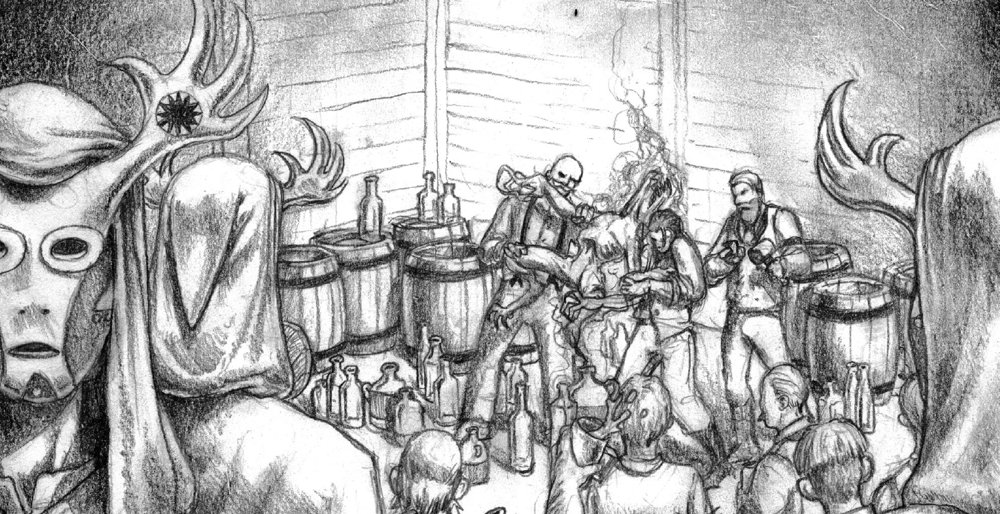

# Часть V. Сказания Мифов

## Вводный сценарий: «Неласковый приём»

Это короткое вводное приключение призвано познакомить новых персонажей (и игроков) с каторжным поселением Новый Южный Уэльс. Сыщики — пассажиры одного из двух судов, «Эмили» и «Лалворт-Ков», которые после месяцев в море как раз входят в гавань Порт-Джексон. Однако из-за распространения загадочной болезни обоим судам запрещено швартоваться у Казённой пристани. Сотни каторжников, военных и свободных поселенцев застряли в гавани — в виду конечной цели своего пути. Странные события заставляют капитанов обоих судов потребовать расследования… но лишь горстка людей на обоих судах свободна от загадочной заразы. Эта пёстрая компания преступников, тюремщиков и поселенцев — и есть сыщики.

Сценарий рассчитан всего на одну игровую сессию и годится как для новичков, так и для опытных игроков. Он подходит для сыщиков самого разного происхождения: каторжники и солдаты Корпуса Нового Южного Уэльса плывут на казённом транспорте для каторжников «Эмили», а публика почище (высокие правительственные чиновники или свободные поселенцы) — на купеческом судне «Лалворт-Ков». Оба судна идут вместе — так безопаснее, — но связи между ними почти нет, если не считать редких стоянок в портах по пути.

*Прим. перев.:* английское название сценария «Un-Fresh Off The Boat» обыгрывает выражение *fresh off the boat* («только что с корабля», о новоприбывших); в переводе — «Неласковый приём», как в базе.
